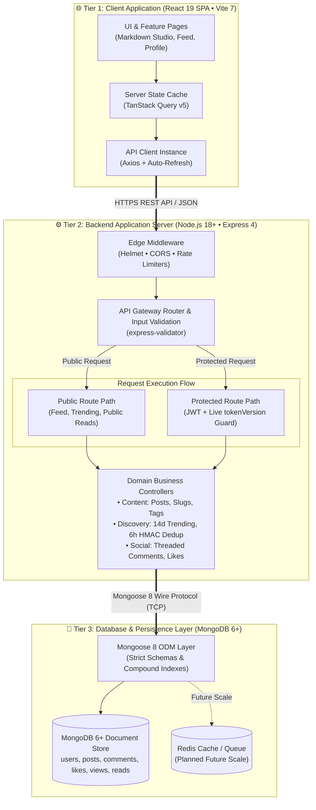
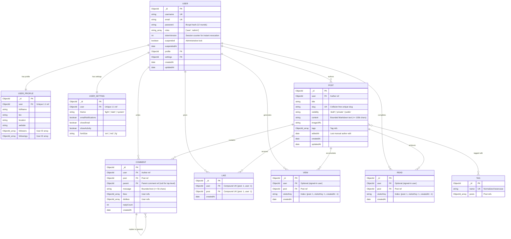
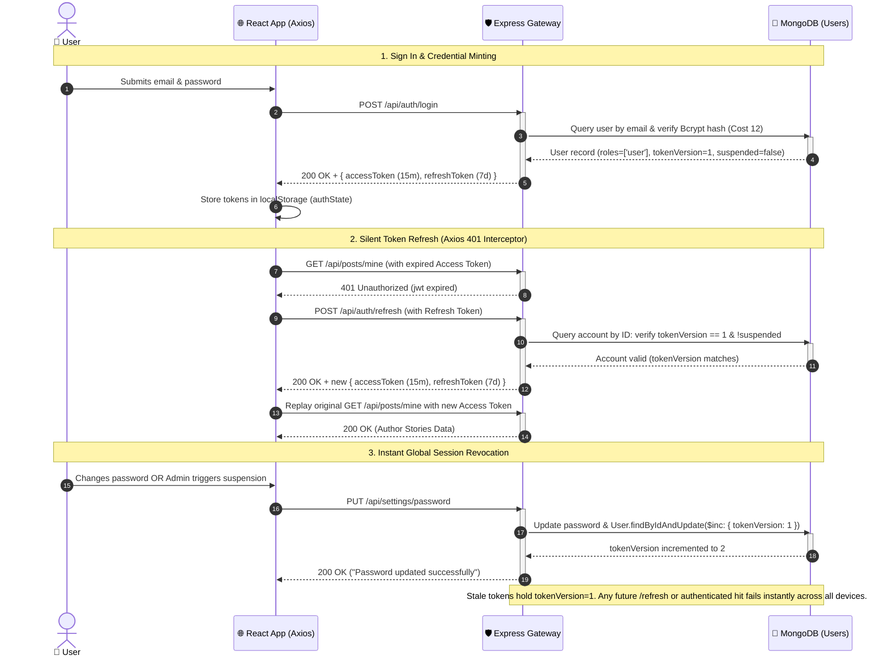
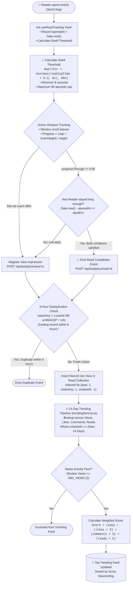

# BlogHub Architecture

This document explains how BlogHub is put together: what the main pieces are, how data is stored, how login and sessions work, how "trending" is calculated, and what we do to keep the app secure.

If you are new to the codebase, read sections 1 and 2 first. Sections 3 to 5 go deeper into the parts that are easiest to get wrong.

All diagrams are written in [Mermaid](https://mermaid.js.org/), so they render directly on GitHub and stay in version control next to the code.

**Contents**

1. [System overview](#1-system-overview)
2. [Data model](#2-data-model)
3. [Authentication and session revocation](#3-authentication-and-session-revocation)
4. [Read tracking and trending](#4-read-tracking-and-trending)
5. [Security](#5-security)
6. [Testing](#6-testing)
7. [Architecture Decision Records (ADRs)](#7-architecture-decision-records-adrs)

---

## 1. System Overview

BlogHub is a classic three-tier web app:

- **Client:** a React single page app that runs in the browser.
- **Server:** a Node.js and Express API that holds all the business logic.
- **Database:** MongoDB, accessed through Mongoose.

The client and server are fully separate. They only talk over HTTPS using a JSON REST API, so either side can be deployed or replaced on its own.



### How a request moves through the system

1. **Client (`client/src/`).** Built with React 19, Tailwind CSS v4, and Radix UI. Organized following a **Feature-Driven Architecture** (`src/features/`), where each domain (auth, posts, users, comments, analytics, admin) encapsulates its own components, custom hooks, pages, services, and colocated tests behind a clear `index.js` public boundary. Server state is fetched and cached with TanStack Query v5 using centralized `config/queryKeys.js`. When an access token expires, Axios catches the 401, asks the server for a new token pair via `POST /api/auth/refresh`, and replays the failed requests seamlessly.
2. **Edge of the server (`backend/index.js`).** Every request first passes through Helmet (security headers), CORS (only our frontend origin is allowed) and rate limiters (300 requests per 15 minutes for the general API, 10 per 15 minutes for login attempts). We also set `trust proxy: 1`, so the server sees the real client IP when it runs behind a load balancer or CDN such as Vercel or Nginx.
3. **Routing and validation.** Routes are split into public (feed, trending, reading posts) and protected (writing, liking, settings). Incoming data is checked with `express-validator` before any business logic runs.
4. **Authentication (`backend/middlewares/authenticateUser.js`).** Most JWT setups only check the token signature. We go one step further and load `roles`, `tokenVersion` and `suspended` from MongoDB on every protected request. The extra database read is a deliberate trade-off: when an admin suspends someone or a user changes their password, the old tokens stop working immediately instead of living until they expire.
5. **Persistence (`backend/models/`).** Nine Mongoose schemas define the data. The important rules, like "one like per user per post", are enforced by the database itself through unique indexes, not only by application code.

### Client Architecture: Feature-Driven Domain Colocation

Rather than a traditional horizontal layer structure (`components/`, `hooks/`, `services/`, `pages/`), BlogHub's frontend uses a **Feature-Driven Architecture** (`client/src/features/`). Code is organized vertically by business domain:

- **`features/auth/`** — Login, Registration, `AuthContext`, session state, route guards (`ProtectedRoute`, `AdminRoute`), and auth API services.
- **`features/posts/`** — Home feed, search, reader (`PostDetail`), Markdown editor studio (`WritePost`), story management, draft recovery hooks (`useDraftRecovery`), and post services.
- **`features/users/`** — User profiles, account settings, creator dashboard, and user management services.
- **`features/comments/`** — Reader discussions, nested comment trees, and response services.
- **`features/analytics/`** — Reader telemetry, dwell time tracking, read completion bars (`ReadRateBar`), and analytics services.
- **`features/admin/`** — Moderation console, administrative dashboards, tag manager, user roles, and activity audits.

Each feature folder is self-contained with its own `components/`, `hooks/`, `pages/`, `services/`, and colocated `__tests__/`. Cross-feature interactions are exposed through explicit public barrel interfaces (`index.js`). Shared building blocks (`components/ui/`, `components/layout/`, `config/queryKeys.js`, `styles/ThemeProvider.jsx`) remain global. See [ADR-0008](docs/adr/0008-feature-driven-frontend-architecture.md) for full context and trade-offs.

---

## 2. Data Model

Here is how the collections relate to each other. A few design choices are worth knowing before you read the diagram:

- **Follows have no table of their own.** Followers and followings are stored as arrays of user IDs on `UserProfile` (`backend/models/user-profile.model.js`). This keeps profile lookups to a single query.
- **Likes cannot be duplicated.** `Like` has a unique index on `{ post, user }`. Even if someone double-clicks or two requests arrive at the same moment, the database rejects the second one.
- **`editedAt` is separate from `updatedAt`.** Mongoose bumps `updatedAt` whenever anything changes, including a new like or comment. `editedAt` only changes when the author actually edits the post, so the UI can show a truthful "edited" label.



---

## 3. Authentication and Session Revocation

Login uses two tokens:

- an **access token** that lasts 15 minutes and is sent with every API call;
- a **refresh token** that lasts 7 days and is only used to get a new pair.

Each user also has a number called `tokenVersion`, which is stored in the token and in the database. If the two numbers do not match, the token is rejected. So to log a user out everywhere, we simply increase the number in the database. This happens when a user changes their password or an admin suspends the account.

The diagram shows three moments: signing in, silently refreshing an expired token, and revoking all sessions.



### What this design gives us

- **Instant kill switch.** Because the server compares `tokenVersion` and `suspended` against the database on every protected request, a suspended or password-changed account loses access right away, on every device.
- **No hint about which emails exist.** If an email is not registered, the login code still runs a password check against a fixed dummy hash (`ABSENT_ACCOUNT_HASH`). A wrong email and a wrong password therefore take the same time to answer, so an attacker cannot tell them apart by measuring response time.

---

## 4. Read Tracking and Trending

A page view only says that someone opened a link. It does not say they read anything. BlogHub therefore tracks two separate things:

- a **view**: the reader opened the post;
- a **read**: the reader scrolled to the end *and* spent a realistic amount of time on the page.

Trending posts are then ranked using these signals together with likes and comments, but only from the last 14 days. Older activity does not count, so the trending list stays fresh.



### The rules in plain words

**What counts as a "read"** (`client/src/hooks/useReading.js`)

The reader must do both of these:

1. Scroll through at least 95% of the article.
2. Stay on the page for at least 30% of the estimated reading time, but never less than 8 seconds and never more than 90 seconds.

```
dwellTime = min( max(readingTime × 0.3, 8s), 90s )
```

The 8 second floor stops very short posts from being "read" by scrolling past. The 90 second cap makes sure a long article does not demand minutes of waiting.

**How repeat visits are handled** (`backend/utils/visitor.js`)

Every visitor gets a `visitorKey`. Signed-in users are identified by their user ID (`u:<userId>`). Anonymous visitors get a hashed fingerprint (`a:<hash>`), made from their IP and browser string with HMAC-SHA256 and a server secret, so we never store a raw IP address. If the same key hits the same post again within 6 hours, the event is dropped. This stops people from inflating numbers by refreshing the page.

**How trending is scored** (`backend/services/trendingService.js`)

```
score = views + (likes × 3) + (comments × 5) + (finished reads × 5)
```

- Only activity from the last 14 days is counted.
- A post needs at least 3 views in that window to be considered, so a single click cannot push a post onto the list.
- Comments and finished reads weigh the most because they take real effort. A view takes one click.

---

## 5. Security

Each row below is one protection, how it works, and what attack it is meant to stop.

| Layer | What we do | What it protects against |
| :--- | :--- | :--- |
| Proxy and headers | `trust proxy: 1` and `helmet()` | Wrong client IPs behind proxies, clickjacking, MIME sniffing |
| CORS | Only `CLIENT_URL` is allowed, with credentials | Other websites calling our API from a user's browser |
| Rate limiting | 10 login attempts and 300 API calls per 15 minutes | Password guessing, credential stuffing, request flooding |
| Constant-time login | Dummy hash for unknown emails | Finding out which emails are registered through response timing |
| Markdown sanitizing | `rehype-sanitize` on rendered posts | Malicious scripts hidden in post content (stored XSS) |
| Session revocation | `tokenVersion` checked against the database on every protected request | Stolen or old tokens, delayed effect of suspensions |
| Unique indexes | `{ post, user }` unique on likes, and similar | Duplicate likes or follows caused by simultaneous requests |

### Known trade-offs

- **Tokens live in `localStorage`.** This is simple and works well with a separate frontend, but it means any successful XSS attack could read them. This is the reason the Markdown sanitizing above matters so much. A common alternative is to keep the refresh token in an `httpOnly` cookie, which JavaScript cannot read.
- **One extra database read per protected request.** This is the cost of instant revocation (see section 3). If traffic grows, a short-lived cache for `tokenVersion` can reduce the load, at the price of a small delay before revocation takes effect.

---

## 6. Testing

Tests are split into fast unit tests and slower integration tests that use a real (in-memory) database.

```
          / \
         /   \
        / E2E \       Manual browser QA & Preview deployments
       /-------\
      / Integration \ Full API lifecycles (mongodb-memory-server) &
     /   (55%)       \ RTL Page flows (Mocked Service Boundaries)
    /-----------------\
   /    Unit Tests     \ Pure functions, express-validators, middlewares,
  /       (45%)         \ custom business hooks (useDraftRecovery, useReading)
 /-----------------------\
```

- **Backend:** 15 test suites with 190 tests. Unit tests live in `backend/tests/unit/` and run in milliseconds. Integration tests live in `backend/tests/integration/` and run against `mongodb-memory-server`, so no real database is needed.
- **Frontend:** 15 test suites with 142 tests, placed next to the code in feature `__tests__/` folders and run with Vitest in `jsdom`.
- **Commands:** run everything from the repo root with `npm test`, `npm run test:coverage` and `npm run lint`.

*Test counts are accurate at the time of writing and will change as the project grows.*

---

## 7. Architecture Decision Records (ADRs)

For deep dives into specific engineering trade-offs (e.g., why we chose an in-memory token refresh mechanism, how we prevent duplicate likes under concurrency, or why we use an ephemeral in-memory MongoDB for testing), consult the project ADR directory:

👉 **[Browse Architecture Decision Records (docs/adr/)](docs/adr/README.md)**
