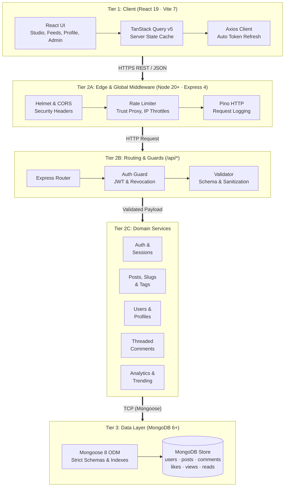

# Architecture

This document explains how the main pieces of BlogHub fit together and how a request moves through them. For the database see [Data Model](docs/DATA_MODEL.md), for login and sessions see [Authentication](docs/AUTHENTICATION.md), for read tracking see [Analytics](docs/ANALYTICS.md), and for protections see [Security Model](docs/SECURITY_MODEL.md).

## Contents

1. [System overview](#1-system-overview)
2. [How a request moves through the system](#2-how-a-request-moves-through-the-system)
3. [Client structure](#3-client-structure)

---

## 1. System overview

BlogHub is a classic three-tier web app:

- **Client:** a React single page app that runs in the browser.
- **Server:** a Node.js and Express API that holds all the business logic.
- **Database:** MongoDB, accessed through Mongoose.

The client and server are fully separate. They only talk over HTTPS using a JSON REST API, so either side can be deployed or replaced on its own.

---

## 2. How a request moves through the system

| Stage                   | What happens                                                                                                                                                                                                                                                                                       |
| :---------------------- | :------------------------------------------------------------------------------------------------------------------------------------------------------------------------------------------------------------------------------------------------------------------------------------------------- |
| **Client**              | The React app (React 19, Tailwind CSS v4, Radix UI) fetches and caches server data with TanStack Query. When an access token expires, Axios catches the 401, asks the server for a new token pair, and replays the failed requests without interrupting the user.                                  |
| **Server edge**         | Every request first passes through security headers, CORS, rate limiters, and request logging. The server trusts one proxy hop, so it sees the real client IP behind a load balancer or CDN.                                                                                                       |
| **Core infrastructure** | Shared technical concerns live in one place: error handling, logging, file uploads, request validation, and async helpers.                                                                                                                                                                         |
| **Auth guard**          | On every protected request the server loads the user's roles, `tokenVersion`, and `suspended` flag from MongoDB. The extra read is deliberate: when an admin suspends someone or a user changes their password, old tokens stop working immediately. See [Authentication](docs/AUTHENTICATION.md). |
| **Persistence**         | Nine Mongoose schemas define the data, each kept inside its own domain module. Important rules, like "one like per user per post", are enforced by the database through unique indexes. See [Data Model](docs/DATA_MODEL.md).                                                                      |

---

## 3. Client structure

The frontend is organized by business domain instead of by file type. Each feature folder is self-contained, with its own components, hooks, pages, services, and tests, and exposes a public interface through an `index.js` file.

| Feature     | What it owns                                                                         |
| :---------- | :----------------------------------------------------------------------------------- |
| `auth`      | Login, registration, session state, route guards                                     |
| `posts`     | Home feed, search, article reader, Markdown editor, story management, draft recovery |
| `users`     | Profiles, account settings, creator dashboard                                        |
| `comments`  | Discussions and nested comment trees                                                 |
| `analytics` | Reader tracking, dwell time, read-completion bars                                    |
| `admin`     | Moderation console, tag manager, user roles, activity logs                           |

Shared building blocks (UI components, layout, query keys, theme) stay global. The reasoning is in [ADR-0008](docs/adr/0008-feature-driven-frontend.md). The component tiers and theme tokens are in [Design System](docs/DESIGN_SYSTEM.md).
