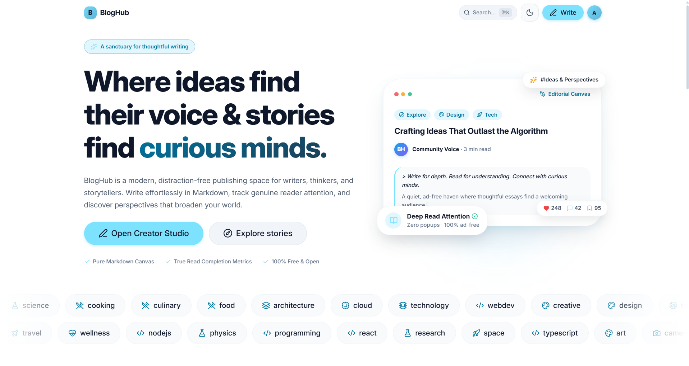
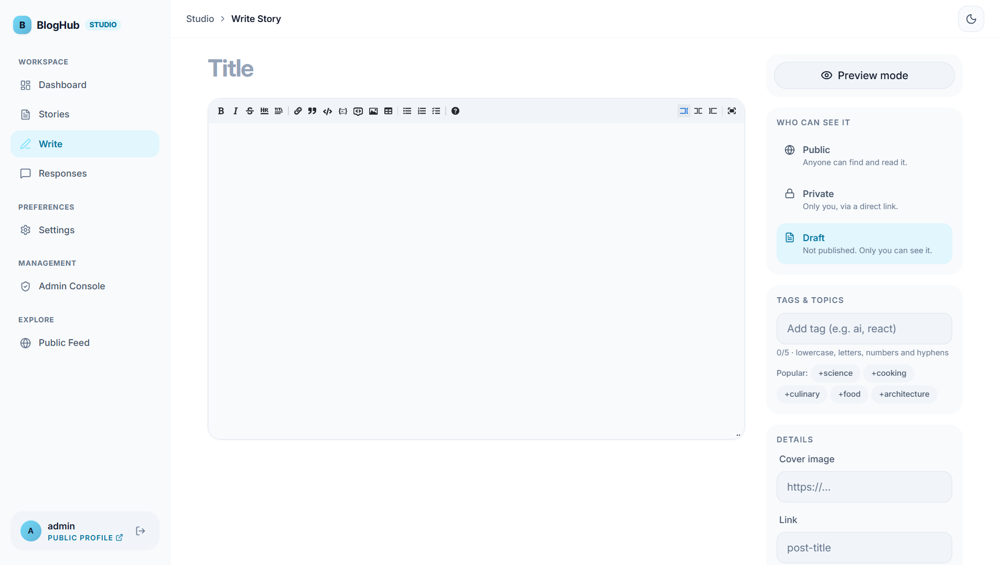
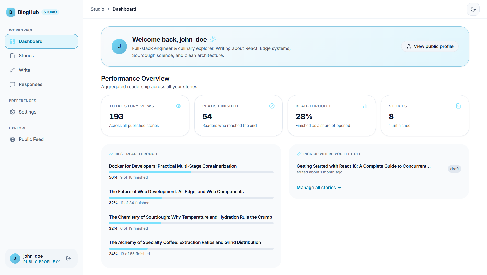
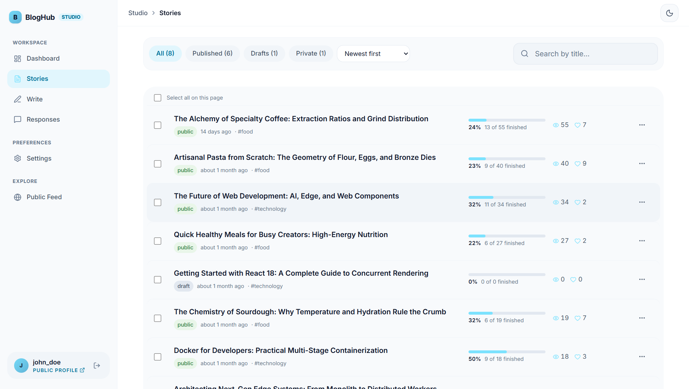
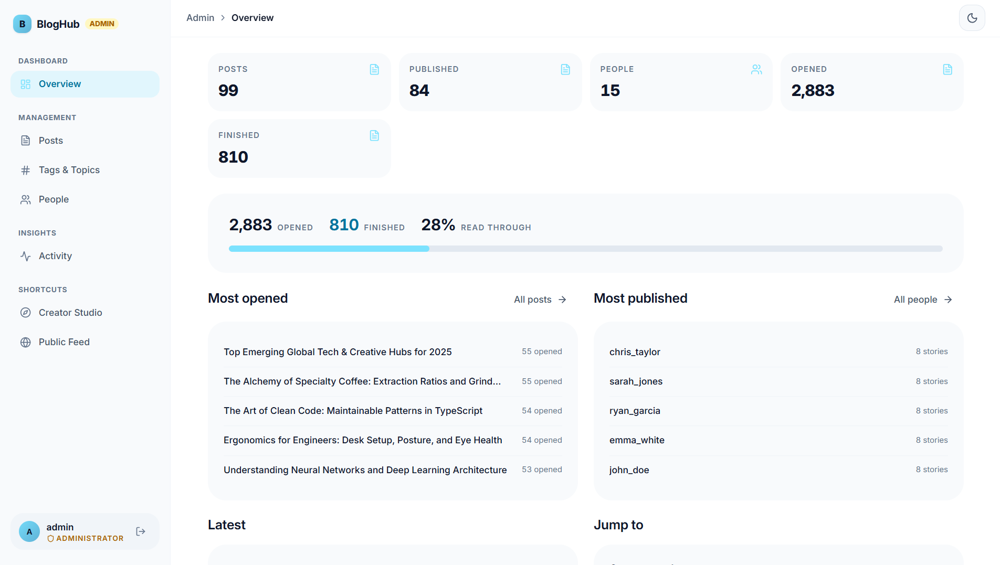
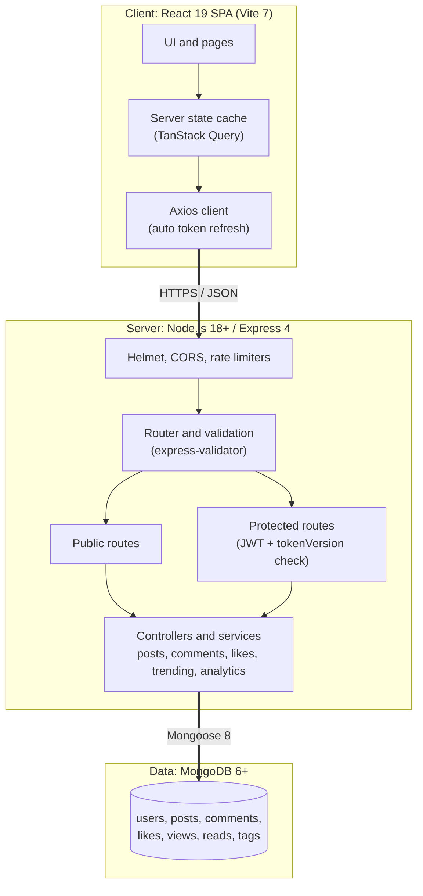

# BlogHub

An open-source, full-stack publishing platform focused on read-through engagement analytics, live Markdown authoring, and platform moderation.

[](https://github.com/Purvesh-PJ/blogging_platform/actions/workflows/ci.yml)
[](LICENSE)
[](https://nodejs.org/)
[](https://react.dev/)
[](https://www.mongodb.com/)

**[Live Demo](https://bloghub-gold.vercel.app/)** · [Architecture](ARCHITECTURE.md) · [Contributing](CONTRIBUTING.md)



## Table of Contents

- [Overview](#overview)
- [Features](#features)
- [Screenshots](#screenshots)
- [Architecture](#architecture)
- [Tech Stack](#tech-stack)
- [Getting Started](#getting-started)
- [Environment Variables](#environment-variables)
- [Demo Accounts](#demo-accounts)
- [API Overview](#api-overview)
- [Scripts and Testing](#scripts-and-testing)
- [Project Structure](#project-structure)
- [Deployment](#deployment)
- [Roadmap and Known Limitations](#roadmap-and-known-limitations)
- [Contributing](#contributing)
- [License](#license)

## Overview

Most blogging tools report page views. BlogHub tracks **read-through rate**: how many visitors actually finish an article. This metric drives both the author analytics dashboard and the trending feed.

The project has three user-facing areas:

| Readers | Authors | Administrators |
| :-- | :-- | :-- |
| 720px reading column | Split-pane live Markdown editor | Story moderation (public/private) |
| Sanitized Markdown rendering | Auto-generated, editable slugs | User management and role promotion |
| 14-day trending feed | Cover image and up to 5 tags per story | Instant session revocation |
| Threaded comments and likes | Read-through analytics dashboard | Site-wide health metrics |

## Features

**Authoring**
- Split-screen Markdown editor with live preview.
- Server-enforced visibility states: `draft`, `private`, `public`.
- Auto-generated URL slugs with manual override.
- Cover image support and tags created on demand.

**Reading and social**
- Light and dark themes.
- Trending ranking over a 14-day window, weighted by verified read completions.
- Nested (threaded) comments.
- Idempotent likes and follows, enforced by MongoDB compound unique indexes.

**Analytics**
- Per-author view-to-read conversion metrics.
- Visitor deduplication using salted HMAC hashes over a 6-hour sliding window.
- Separate author-level and platform-level (admin) analytics.

**Security**
- Dual-token JWT: access token (15 min) and refresh token (7 days), with silent renewal through an Axios interceptor.
- Any credential change increments `tokenVersion`, which invalidates all active tokens across devices.
- Helmet security headers, CORS origin pinning, rate limiting, `express-validator` input validation, and `rehype-sanitize` for rendered Markdown.

## Screenshots

| | |
| :-: | :-: |
| <br/>**Landing and trending feed** (`/`) | <br/>**Reading view** (`/post/:id`) |
| <br/>**Markdown editor** (`/write`) | <br/>**Author analytics** (`/dashboard`) |
| <br/>**Story management** (`/stories`) | <br/>**Admin console** (`/admin`) |

## Architecture

BlogHub is a decoupled three-tier application: a React 19 single-page app, a stateless Express 4 REST API, and a MongoDB database.

For the full specification (ERD, auth sequence flows, security boundaries, testing strategy), see [ARCHITECTURE.md](ARCHITECTURE.md).



## Tech Stack

| Layer | Technologies |
| :-- | :-- |
| Frontend | React 19, Vite 7, Tailwind CSS 4, Radix UI, TanStack Query 5, React Router 7, Axios, `@uiw/react-md-editor` |
| Backend | Node.js 18+, Express 4, Mongoose 8, jsonwebtoken, bcryptjs, express-validator, helmet, express-rate-limit, multer |
| Database | MongoDB 6.0+ (local or Atlas) |
| Testing | Jest, Vitest, Supertest, React Testing Library, mongodb-memory-server |
| CI/CD | GitHub Actions (lint, format check, tests, build, dependency audit), Vercel |

## Getting Started

### Prerequisites

- Node.js 18.0.0 or later
- MongoDB 6.0+ (local instance or [MongoDB Atlas](https://www.mongodb.com/atlas))

### 1. Clone and configure

```bash
git clone https://github.com/Purvesh-PJ/blogging_platform.git
cd blogging_platform
cp .env.example .env
```

Both workspaces read a single `.env` file at the repository root. See [Environment Variables](#environment-variables).

Generate secrets with:

```bash
node -e "console.log(require('crypto').randomBytes(48).toString('hex'))"
```

### 2. Install dependencies

```bash
cd backend && npm install
cd ../client && npm install
```

### 3. Seed the database (optional)

```bash
cd backend && npm run seed
```

> **Warning:** the seeder deletes existing data in the target collections before inserting sample data. Never run it against a production database.

### 4. Start the development servers

```bash
# Terminal 1: API on http://localhost:4000
cd backend && npm run dev

# Terminal 2: client on http://localhost:3000
cd client && npm run dev
```

Open http://localhost:3000.

## Environment Variables

| Variable | Required | Default / Example | Description |
| :-- | :-: | :-- | :-- |
| `NODE_ENV` | No | `development` | Runtime environment. |
| `PORT` | No | `4000` | API server port. |
| `MONGO_DB_URI` | Yes | `mongodb://127.0.0.1:27017/bloghub` | MongoDB connection string. |
| `CLIENT_URL` | Yes | `http://localhost:3000` | Allowed CORS origin. |
| `VITE_API_URL` | Yes | `http://localhost:4000` | API base URL used by the client. |
| `JWT_SECRET` | Yes | none | Access token signing secret (minimum 32 characters). |
| `JWT_REFRESH_SECRET` | Yes | none | Refresh token signing secret. Must differ from `JWT_SECRET`. |
| `JWT_ACCESS_EXPIRES_IN` | No | `15m` | Access token lifetime. |
| `JWT_REFRESH_EXPIRES_IN` | No | `7d` | Refresh token lifetime. |

The backend validates required variables at boot (`backend/config/env.js`) and exits with an error if any are missing.

## Demo Accounts

Created by `npm run seed`. **For local development only.**

| Role | Email | Password |
| :-- | :-- | :-- |
| Member (author) | `john@example.com` | `password123` |
| Administrator | `admin@bloghub.com` | `admin123` |

The hosted demo may reset data periodically.

## API Overview

All endpoints are mounted under `/api`. Protected routes require an `Authorization: Bearer <accessToken>` header.

| Resource | Base path | Auth | Description |
| :-- | :-- | :-- | :-- |
| Auth | `/api/auth` | Mixed | Register, login, token refresh, logout. |
| Posts | `/api/posts` | Mixed | Create, read, update, delete, visibility, slugs, moderation. |
| Users | `/api/users` | Mixed | Profiles, follow/unfollow, admin user management. |
| Comments | `/api/comments` | Mixed | Threaded comments on posts. |
| Likes | `/api/likes` | Required | Idempotent like and unlike. |
| Tags | `/api/tags` | Mixed | Tag listing and lookup. |
| Analytics | `/api/analytics` | Required | Author read-through and telemetry metrics. |

## Scripts and Testing

Run from the repository root:

| Command | Description |
| :-- | :-- |
| `npm test` | Run backend and client test suites. |
| `npm run test:backend` | Backend tests only (Jest). |
| `npm run test:client` | Client tests only (Vitest). |
| `npm run test:coverage` | Coverage reports for both workspaces. |
| `npm run lint` / `npm run lint:fix` | ESLint check or auto-fix. |
| `npm run format:check` / `npm run format` | Prettier check or write. |
| `npm run build` | Production build of the client. |

**Backend** (`cd backend`)

| Command | Description |
| :-- | :-- |
| `npm run dev` | Start the API with nodemon. |
| `npm run test:unit` | Unit tests (middlewares, utils, validators). |
| `npm run test:integration` | API integration tests against an in-memory MongoDB. |
| `npm run seed` | Populate demo data. |
| `npm run migrate` | Run database migrations (`--dry` to preview). |

**Client** (`cd client`)

| Command | Description |
| :-- | :-- |
| `npm run dev` | Vite dev server on port 3000. |
| `npm run test:watch` | Vitest in watch mode. |
| `npm run preview` | Preview the production build locally. |

Test counts and coverage are reported by CI. See the CI badge above and the latest workflow run.

## Project Structure

```
.
├── .github/workflows/ci.yml   # Lint, format, test, build, audit
├── backend/                   # Express 4 REST API (CommonJS)
│   ├── config/                # DB connection, env validation
│   ├── controllers/           # HTTP request/response handlers
│   ├── middlewares/           # Auth, roles, validation, upload, error handling
│   ├── models/                # Mongoose schemas
│   ├── routes/                # Express routers mounted under /api
│   ├── services/              # Business logic (posts, comments, accounts, trending)
│   ├── validators/            # express-validator rule sets
│   └── tests/                 # unit/ and integration/
├── client/                    # React 19 SPA (Vite)
│   ├── public/screenshots/
│   └── src/
│       ├── components/        # ui primitives, posts, layout, marketing
│       ├── context/           # Auth and theme providers
│       ├── guards/            # Route protection
│       ├── hooks/
│       ├── pages/             # Reader, author, and admin pages
│       ├── services/          # API clients
│       └── utils/
├── .env.example
├── vercel.json
├── CONTRIBUTING.md
└── LICENSE
```

## Deployment

The live demo runs on Vercel using the configuration in `vercel.json`.

1. Provision a MongoDB Atlas cluster and create a database user.
2. Import the repository into Vercel.
3. Set all required [environment variables](#environment-variables) in the Vercel project settings. Use production-grade secrets, and set `CLIENT_URL` and `VITE_API_URL` to the deployed URLs.
4. Deploy. Do not run `npm run seed` against the production database.

## Roadmap and Known Limitations

- [ ] Redis for caching and background jobs (not implemented yet).
- [ ] OpenAPI / Swagger documentation.
- [ ] Image upload storage on external object storage.
- [ ] Email verification and password reset flow.

## Contributing

Contributions are welcome.

1. Fork the repository.
2. Create a branch: `git checkout -b feature/your-feature`.
3. Commit using [Conventional Commits](https://www.conventionalcommits.org/): `git commit -m "feat: add your feature"`.
4. Run `npm test` and `npm run format:check`.
5. Push and open a pull request.

Please read [CONTRIBUTING.md](CONTRIBUTING.md) first.

## License

Released under the [MIT License](LICENSE).
