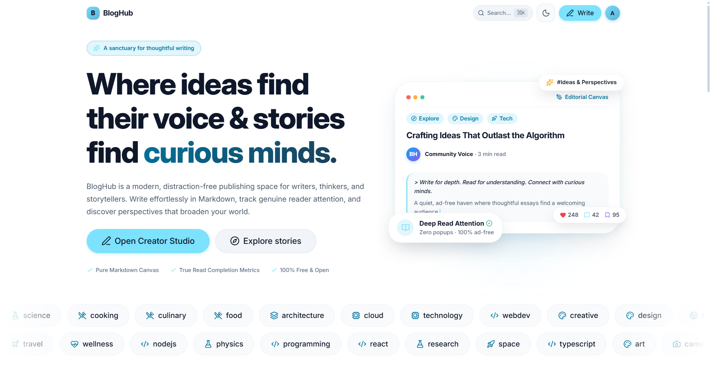
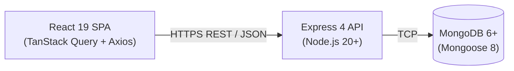

# BlogHub

**A blogging platform that measures whether readers actually finish an article, not just whether they click.**

Live Markdown studio · Read-through analytics · Trending feed · Admin moderation

[**Live Demo**](https://bloghub-gold.vercel.app/) · [Architecture](ARCHITECTURE.md) · [API Reference](docs/API.md) · [Development](docs/DEVELOPMENT.md)

 

---

## What it does

- **Readers** get a focused reading layout, light and dark themes, a trending feed, threaded comments, and likes.
- **Authors** write in a live Markdown editor with automatic slugs, draft recovery, cover images, and read-completion stats for each story.
- **Moderators** get an admin dashboard to manage stories, tags, and users, and can end a user's sessions instantly.

## How it works

The client and the API are separate and talk only through a JSON REST API. The detailed diagram and request flow are in [Architecture](ARCHITECTURE.md).

## Tech stack

- **Frontend:** React 19, Vite 7, Tailwind CSS v4, Radix UI, TanStack Query v5
- **Backend:** Node.js 20+, Express 4
- **Data & Testing:** MongoDB 6+ (Mongoose 8), Jest, Vitest

## Documentation

| Doc | What it covers |
| :-- | :------------- |
| [Development](docs/DEVELOPMENT.md) | Prerequisites, local setup, environment variables, and running dev servers |
| [API Reference](docs/API.md) | REST endpoints, auth headers, and response shapes |
| [Testing](docs/TESTING.md) | Test suites, in-memory DB setup, and commands |
| [Deployment](docs/DEPLOYMENT.md) | Production build, proxy setup, and health checks |
| [Architecture](ARCHITECTURE.md) | System structure and how a request flows through it |
| [Database](docs/DATABASE.md) | Connection, migrations, seeding, and health checks |
| [Data Model](docs/DATA_MODEL.md) | Collections, relationships, and indexes |
| [Authentication](docs/AUTHENTICATION.md) | Login, token refresh, and session revocation |
| [Analytics](docs/ANALYTICS.md) | Read tracking and the trending score |
| [Design System](docs/DESIGN_SYSTEM.md) | UI tiers, theme tokens, and lint rules |
| [Security Model](docs/SECURITY_MODEL.md) | Protections in place and known trade-offs |
| [Security Policy](SECURITY.md) | Supported versions and how to report a vulnerability |
| [Decision Records](docs/adr/README.md) | Why key technical choices were made |
| [Contributing](CONTRIBUTING.md) | Branching, commit conventions, and PR workflow |
| [Changelog](CHANGELOG.md) | Version history and release notes |

## License

[MIT](LICENSE)
