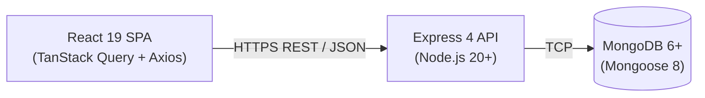

# BlogHub

**A full-stack blogging platform for writing, reading, and measuring real reader engagement.**

Write in a live Markdown studio, explore a trending feed powered by genuine read-through signals, and manage content with built-in moderation tools.

[**Live Demo**](https://bloghub-gold.vercel.app/) · [Architecture](ARCHITECTURE.md) · [API Reference](docs/API.md) · [Development](docs/DEVELOPMENT.md)

 

---

## Key Features

- **Readers:** Focused reading layout, light and dark themes, a trending feed, threaded comments, and likes.
- **Authors:** Live split-pane Markdown editor with automatic slugs, draft recovery, cover images, and read-completion stats for each story.
- **Moderators:** Admin dashboard to manage stories, tags, and users, with instant session revocation.

## How it works

The client and the API are separate and talk only through a JSON REST API. The detailed diagram and request flow are in [Architecture](ARCHITECTURE.md).

## Tech stack

- **Frontend:** React 19, Vite 7, Tailwind CSS v4, Radix UI, TanStack Query v5
- **Backend:** Node.js 20+, Express 4
- **Data & Testing:** MongoDB 6+ (Mongoose 8), Jest, Vitest

## Documentation

| Doc                                      | What it covers                                                             |
| :--------------------------------------- | :------------------------------------------------------------------------- |
| [Development](docs/DEVELOPMENT.md)       | Prerequisites, local setup, environment variables, and running dev servers |
| [API Reference](docs/API.md)             | REST endpoints, auth headers, and response shapes                          |
| [Testing](docs/TESTING.md)               | Test suites, in-memory DB setup, and commands                              |
| [Quality & Audits](docs/QUALITY.md)      | Linting, formatting, bundle budgets, and Lighthouse checks                 |
| [Deployment](docs/DEPLOYMENT.md)         | Production build, proxy setup, and health checks                           |
| [Architecture](ARCHITECTURE.md)          | System structure and how a request flows through it                        |
| [Database](docs/DATABASE.md)             | Connection, migrations, seeding, and health checks                         |
| [Data Model](docs/DATA_MODEL.md)         | Collections, relationships, and indexes                                    |
| [Authentication](docs/AUTHENTICATION.md) | Login, token refresh, and session revocation                               |
| [Analytics](docs/ANALYTICS.md)           | Read tracking and the trending score                                       |
| [Design System](docs/DESIGN_SYSTEM.md)   | UI tiers, theme tokens, and lint rules                                     |
| [Security Model](docs/SECURITY_MODEL.md) | Protections in place and known trade-offs                                  |
| [Security Policy](SECURITY.md)           | Supported versions and how to report a vulnerability                       |
| [Decision Records](docs/adr/README.md)   | Why key technical choices were made                                        |
| [Contributing](CONTRIBUTING.md)          | Branching, commit conventions, and PR workflow                             |
| [Changelog](CHANGELOG.md)                | Version history and release notes                                          |

## License

Copyright © 2024–2026 Purvesh-PJ. All Rights Reserved. See [LICENSE](LICENSE) for details.
