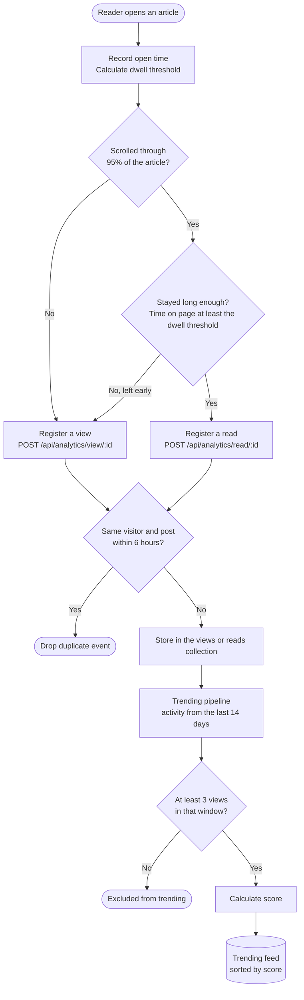

# Analytics

This document explains how BlogHub decides that someone has actually read an article, and how the trending feed is ranked. For the collections these events are stored in see [Data Model](DATA_MODEL.md).

## Views and reads

A page view only says that someone opened a link. It does not say they read anything. BlogHub tracks two separate things:

- a **view**: the reader opened the post;
- a **read**: the reader scrolled to the end and also spent a realistic amount of time on the page.

Trending posts are ranked using these signals together with likes and comments, but only from the last 14 days, so the list stays fresh.



## The rules in plain words

### What counts as a read

The reader must do both of these:

1. Scroll through at least 95% of the article.
2. Stay on the page for at least 30% of the estimated reading time, but never less than 8 seconds and never more than 90 seconds.

```text
dwellTime = min( max(readingTime × 0.3, 8s), 90s )
```

The 8 second floor stops very short posts from being "read" by scrolling past. The 90 second cap makes sure a long article does not demand minutes of waiting.

### How repeat visits are handled

Every visitor gets a `visitorKey`. Signed-in users are identified by their user ID. Anonymous visitors get a hashed fingerprint made from their IP and browser string with HMAC-SHA256 and a server secret, so a raw IP address is never stored. If the same key hits the same post again within 6 hours, the event is dropped. This stops people from inflating numbers by refreshing the page.

### How trending is scored

```text
score = views + (likes × 3) + (comments × 5) + (finished reads × 5)
```

- Only activity from the last 14 days is counted.
- A post needs at least 3 views in that window to be considered, so a single click cannot push a post onto the list.
- Comments and finished reads weigh the most because they take real effort. A view takes one click.
