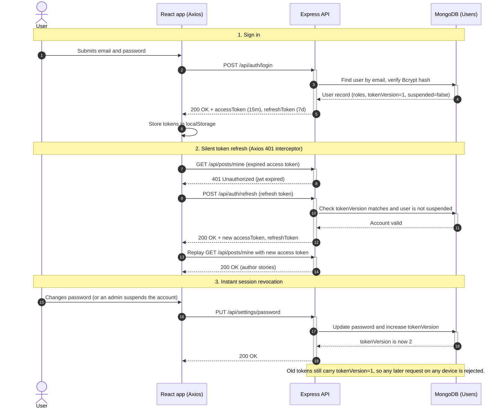

# Authentication

This document explains how login works, how expired tokens are refreshed, and how a user's sessions can be ended instantly. For the other protections in the app see [Security Model](SECURITY_MODEL.md).

## How it works

Login uses two tokens:

- an **access token** that lasts 15 minutes and is sent with every API call;
- a **refresh token** that lasts 7 days and is only used to get a new pair.

Each user also has a number called `tokenVersion`, stored both in the token and in the database. If the two numbers do not match, the token is rejected. To log a user out everywhere, the server simply increases the number in the database. This happens when a user changes their password or an admin suspends the account.

The diagram shows three moments: signing in, silently refreshing an expired token, and revoking all sessions.

## What this design gives us

- **Instant kill switch.** The server compares `tokenVersion` and `suspended` with the database on every protected request, so a suspended or password-changed account loses access right away, on every device.
- **No hint about which emails exist.** If an email is not registered, the login code still checks the password against a fixed dummy hash. A wrong email and a wrong password take the same time to answer, so an attacker cannot tell them apart by measuring response time.
