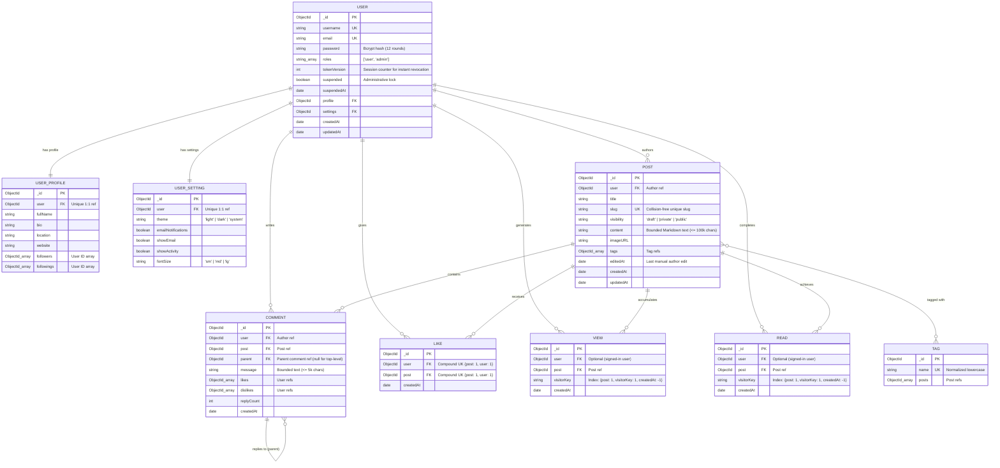

# Data Model

BlogHub stores its data in nine MongoDB collections, defined as Mongoose schemas. This document shows how they relate. For where the database sits in the system see [Architecture](ARCHITECTURE.md).

## Design choices worth knowing

- **Follows have no collection of their own.** Followers and followings are stored as arrays of user IDs on `UserProfile`, so a profile lookup needs only one query.
- **Likes cannot be duplicated.** `Like` has a unique index on `{ post, user }`. Even if someone double-clicks or two requests arrive at the same moment, the database rejects the second one.
- **`editedAt` is separate from `updatedAt`.** Mongoose changes `updatedAt` whenever anything changes, including a new like or comment. `editedAt` changes only when the author edits the post, so the "edited" label in the UI is truthful.

## Entity relationships

