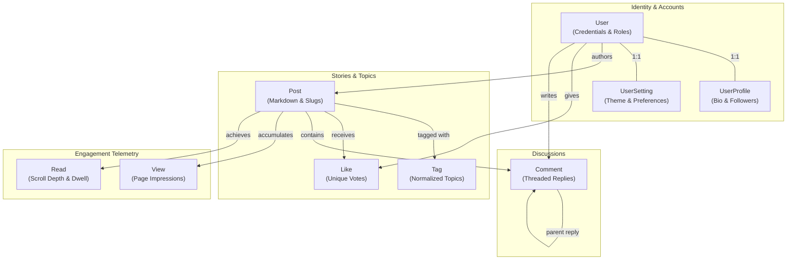

# Data Model

BlogHub organizes its data into nine MongoDB collections across four business domains. This document explains collection schemas, relationships, and index guarantees.

---

## 1. Identity & Accounts

Account data is split into three separate collections to isolate sensitive credentials from public profiles and client preferences:

| Collection | Model Path | Purpose | Key Fields |
|---|---|---|---|
| `User` | `modules/users/models/user.model.js` | Authentication & authorization credentials | `username`, `email`, `password` (bcrypt cost 12), `roles` (`['user', 'admin']`), `tokenVersion`, `suspended` |
| `UserProfile` | `modules/users/models/user-profile.model.js` | Public author information & social graph | `user` (unique 1:1 ref), `fullName`, `bio`, `location`, `website`, `followers` (`ObjectId[]`), `followings` (`ObjectId[]`) |
| `UserSetting` | `modules/users/models/user-settings.model.js` | Reader UI & notification preferences | `user` (unique 1:1 ref), `theme` (`'light' \| 'dark' \| 'system'`), `emailNotifications`, `showEmail`, `showActivity` |

> **Followers Pattern:** Followers and followings are stored as arrays of User IDs directly on `UserProfile`. This avoids an extra query or join table during profile lookups.

---

## 2. Stories & Publishing

Manages Markdown content, taxonomy tags, and unique reader likes:

| Collection | Model Path | Purpose | Key Fields |
|---|---|---|---|
| `Post` | `modules/posts/models/post.model.js` | Article content, metadata & lifecycle | `user` (author ref), `title`, `slug` (unique), `content` (Markdown, max 100k chars), `visibility` (`'draft' \| 'private' \| 'public'`), `tags` (`Tag[]`), `editedAt` |
| `Tag` | `modules/posts/models/tag.model.js` | Discovery taxonomy topics | `name` (unique, normalized lowercase), `posts` (`Post[]`) |
| `Like` | `modules/posts/models/like.model.js` | Reader appreciation ledger | `post` (Post ref), `user` (User ref) |

- **Collision-free Slugs:** Generated automatically from post titles, normalized, and enforced unique via database index.
- **`editedAt` vs `updatedAt`:** Mongoose updates `updatedAt` on every interaction (new comment, view, or like). `editedAt` is updated only when the author explicitly modifies post content, ensuring truthful "Edited" badges in the reader UI.
- **Unique Likes:** The `Like` collection enforces a compound unique index on `{ post: 1, user: 1 }`, guaranteeing that concurrent requests cannot generate duplicate likes.

---

## 3. Discussions & Comments

Threaded conversations attached to posts:

| Collection | Model Path | Purpose | Key Fields |
|---|---|---|---|
| `Comment` | `modules/comments/models/comment.model.js` | Threaded discussions & responses | `user` (author ref), `post` (post ref), `parent` (`ObjectId \| null`), `message` (max 5k chars), `likes`, `dislikes`, `replyCount` |

- **Threaded Nested Replies:** Top-level comments set `parent: null`. Replies reference their parent comment ID (`parent: commentId`). Queries for root comments filter on `parent: null`, and child replies are fetched by parent reference without deep recursion.

---

## 4. Telemetry & Read Tracking

Distinguishes between casual clicks and verified article completions:

| Collection | Model Path | Purpose | Key Fields |
|---|---|---|---|
| `View` | `modules/analytics/models/view.model.js` | Page view impression | `post`, `user` (optional), `visitorKey`, `createdAt` |
| `Read` | `modules/analytics/models/read.model.js` | Verified article completion | `post`, `user` (optional), `visitorKey`, `createdAt` |

- **View vs Read:** A `View` records when someone opens a story. A `Read` records only when the reader scrolls through $\ge 95\%$ of the article and meets the calculated dwell time threshold ($\min(\max(time \times 0.3, 8s), 90s)$).
- **6-Hour Deduplication:** Both collections index `{ post: 1, visitorKey: 1, createdAt: -1 }`. Repeat visits from the same user or anonymous fingerprint within 6 hours are dropped.

---

## Critical Database Indexes

These indexes enforce core data constraints and query performance directly at the database layer:

| Collection | Index Fields | Constraint / Purpose |
|---|---|---|
| `User` | `{ email: 1 }`, `{ username: 1 }` | **Unique**: Prevents duplicate account registration |
| `Post` | `{ slug: 1 }` | **Unique**: Ensures collision-free clean story URLs |
| `Tag` | `{ name: 1 }` | **Unique**: Normalizes topics in lowercase |
| `Like` | `{ post: 1, user: 1 }` | **Compound Unique**: Rejects duplicate likes from concurrent requests |
| `UserProfile` | `{ user: 1 }` | **Unique**: Enforces strict 1:1 user-to-profile relationship |
| `UserSetting` | `{ user: 1 }` | **Unique**: Enforces strict 1:1 user-to-settings relationship |
| `Comment` | `{ post: 1, parent: 1 }` | **Compound**: Accelerates post-scoped threaded comment fetching |
| `View` / `Read` | `{ post: 1, visitorKey: 1, createdAt: -1 }` | **Compound**: Powers 6-hour event deduplication |
