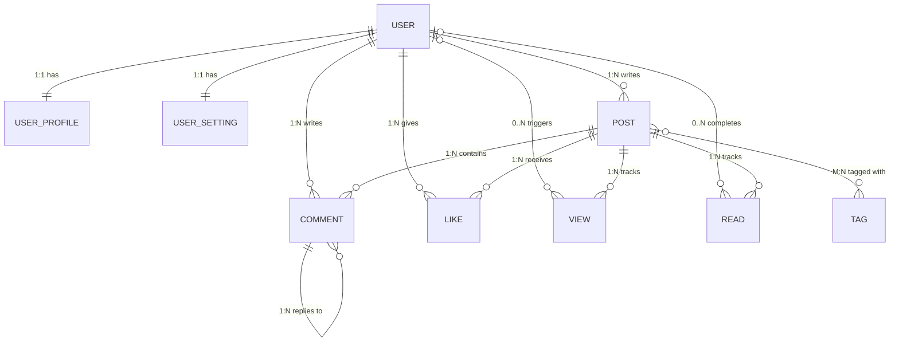

# Data Model

BlogHub stores data in nine MongoDB collections using Mongoose 8. All schemas enable `timestamps` (`createdAt`, `updatedAt`).

## Entity Relationships

### Relationship Reference

| From | To | Type | Meaning |
| :--- | :--- | :--- | :--- |
| `User` | `UserProfile` | `1 : 1` | Each account has one public profile |
| `User` | `UserSetting` | `1 : 1` | Each account has one private settings document |
| `User` | `Post` | `1 : N` | One author can write many posts |
| `User` | `Comment` | `1 : N` | One user can write many comments |
| `User` | `Like` | `1 : N` | One user can like many posts (once per post) |
| `User` | `View` / `Read` | `0..1 : N` | Optional link to signed-in reader (`null` for anonymous visitors) |
| `UserProfile` | `User` | `M : N` | Users follow and are followed by other users (`followers`, `followings`) |
| `Post` | `Tag` | `M : N` | A post can have many tags; a tag links to many posts |
| `Post` | `Comment` | `1 : N` | A post contains many top-level comments and replies |
| `Post` | `Like` | `1 : N` | A post receives many unique likes |
| `Post` | `View` / `Read` | `1 : N` | A post accumulates many view impressions and completed reads |
| `Comment` | `Comment` | `1 : N` (Self) | A comment can have many nested replies via `parent` |

---

## 1. Identity & Accounts

### `User`
**Relations:** Has one `UserProfile` (`1:1`) · Has one `UserSetting` (`1:1`) · Writes many `Post`, `Comment`, `Like` (`1:N`) · Optionally triggers `View`, `Read` (`0..1:N`)

| Field | Type / Constraint | Notes |
| :--- | :--- | :--- |
| `username` | `String` · required · unique | Public handle |
| `email` | `String` · required · unique · lowercase | Login identifier |
| `password` | `String` · required | Bcrypt hash |
| `roles` | `[String]` · `['user', 'admin']` | Default `['user']` |
| `tokenVersion` | `Number` · default `0` | Incremented on password change or suspension to invalidate all tokens |
| `suspended` | `Boolean` · default `false` | Admin account lock |
| `suspendedAt` | `Date` | Timestamp when suspended |
| `profile` | `ObjectId` → `UserProfile` | 1:1 profile ref |
| `settings` | `ObjectId` → `UserSetting` | 1:1 settings ref |
| `posts` | `[ObjectId]` → `Post` | Authored post refs |

### `UserProfile`
**Relations:** Belongs to one `User` (`1:1`) · Follows/followed by many `User` (`M:N` via `followers`, `followings`)

| Field | Type / Constraint | Notes |
| :--- | :--- | :--- |
| `user` | `ObjectId` → `User` · required · unique | Owner account |
| `image` | `{ data: Buffer, contentType: String }` | Avatar binary stored in MongoDB |
| `fullName`, `bio`, `location`, `website` | `String` | Public profile details |
| `socialLinks` | `{ twitter, github, linkedin }` | Optional social URLs |
| `followers`, `followings` | `[ObjectId]` → `User` | Embedded arrays (avoids separate join collection) |
| `postCount`, `followersCount`, `followingsCount` | `Number` · default `0` | Cached counters |

### `UserSetting`
**Relations:** Belongs to one `User` (`1:1`)

| Field | Type / Constraint | Notes |
| :--- | :--- | :--- |
| `user` | `ObjectId` → `User` · required · unique | Owner account |
| `theme` | `'light' \| 'dark' \| 'system'` | Default `'system'` |
| `emailNotifications` | `Boolean` · default `true` | Notification toggle |
| `privacySettings` | `{ showEmail: false, showActivity: true }` | Visibility flags |
| `appearance` | `{ fontSize: 'sm' \| 'md' \| 'lg', colorScheme }` | Defaults: `'md'`, `'default'` |

---

## 2. Stories & Publishing

### `Post`
**Relations:** Belongs to one `User` (`N:1`) · Tagged with many `Tag` (`M:N`) · Has many `Comment`, `Like`, `View`, `Read` (`1:N`)

| Field | Type / Constraint | Notes |
| :--- | :--- | :--- |
| `user` | `ObjectId` → `User` | Author |
| `title` | `String` · required · max 200 | Story headline |
| `slug` | `String` · required · unique · max 200 | Collision-free URL slug |
| `imageURL` | `String` · max 2048 | Optional cover image URL |
| `visibility` | `'draft' \| 'private' \| 'public'` | Default `'draft'` |
| `content` | `String` · required · max 100,000 | Markdown body |
| `tags` | `[ObjectId]` → `Tag` | Topic tags |
| `views`, `likes`, `comments` | `[ObjectId]` refs | Denormalized engagement refs |
| `editedAt` | `Date` · default `null` | Updated only on manual content edits (unlike `updatedAt`) |

### `Tag`
**Relations:** Linked with many `Post` (`M:N`)

| Field | Type / Constraint | Notes |
| :--- | :--- | :--- |
| `name` | `String` · required · unique · lowercase · max 30 | Normalized topic name |
| `posts` | `[ObjectId]` → `Post` | Tagged posts |

### `Like`
**Relations:** Belongs to one `User` (`N:1`) and one `Post` (`N:1`) · Unique `{ post, user }` pair

| Field | Type / Constraint | Notes |
| :--- | :--- | :--- |
| `user` | `ObjectId` → `User` | Reader who liked |
| `post` | `ObjectId` → `Post` | Target post |

---

## 3. Discussions

### `Comment`
**Relations:** Belongs to one `User` (`N:1`) and one `Post` (`N:1`) · Self-references `Comment` via `parent` (`1:N` nested replies) · Voted on by `User` (`M:N` via `likes`, `dislikes`)

| Field | Type / Constraint | Notes |
| :--- | :--- | :--- |
| `user` | `ObjectId` → `User` | Comment author |
| `post` | `ObjectId` → `Post` | Parent story |
| `message` | `String` · required · max 5,000 | Comment body |
| `parent` | `ObjectId` → `Comment` · default `null` | `null` for top-level; parent ID for replies |
| `likes`, `dislikes` | `[ObjectId]` → `User` | Comment votes |
| `replies` | `[ObjectId]` → `Comment` | Child reply refs |
| `replyCount` | `Number` · default `0` | Cached reply count |
| `date` | `Date` · default `Date.now` | Comment timestamp |

---

## 4. Telemetry

### `View` & `Read`
**Relations:** Belongs to one `Post` (`N:1`) · Optionally belongs to one `User` (`N:0..1`)

Both collections share the same schema. A `View` records when a post opens; a `Read` records only when the reader scrolls $\ge 95\%$ and satisfies the dwell time threshold.

| Field | Type / Constraint | Notes |
| :--- | :--- | :--- |
| `post` | `ObjectId` → `Post` | Target story |
| `user` | `ObjectId` → `User` | Optional (present when signed in) |
| `visitorKey` | `String` | `u:<userId>` or `a:<hmac>` anonymous fingerprint |

---

## Indexes & Constraints

| Collection | Index | Purpose |
| :--- | :--- | :--- |
| `User` | `{ email: 1 }`, `{ username: 1 }` | **Unique**: Prevents duplicate accounts |
| `UserProfile` | `{ user: 1 }` | **Unique**: Enforces 1:1 link to `User` |
| `UserSetting` | `{ user: 1 }` | **Unique**: Enforces 1:1 link to `User` |
| `Post` | `{ slug: 1 }` | **Unique**: Collision-free story URLs |
| `Post` | `{ visibility: 1, createdAt: -1 }` | Public feed sorting |
| `Post` | `{ user: 1, createdAt: -1 }` | Author posts listing |
| `Post` | `{ editedAt: -1 }`, `{ tags: 1 }` | Moderation log & tag filtering |
| `Post` | `{ title: 'text', content: 'text' }` | Weighted full-text search (`title: 10`, `content: 2`) |
| `Tag` | `{ name: 1 }` | **Unique**: Lowercase topic names |
| `Like` | `{ post: 1, user: 1 }` | **Unique**: Prevents duplicate likes under concurrency |
| `Like` | `{ user: 1, createdAt: -1 }` | User's liked posts lookup |
| `Comment` | `{ post: 1, parent: 1, createdAt: -1 }` | Top-level & nested thread listing |
| `Comment` | `{ post: 1, createdAt: -1 }`, `{ user: 1, createdAt: -1 }` | Post & user comment history |
| `View`, `Read` | `{ post: 1, visitorKey: 1, createdAt: -1 }` | 6-hour repeat-visit deduplication |
| `View`, `Read` | `{ post: 1, createdAt: -1 }`, `{ user: 1, createdAt: -1 }` | 14-day trending window & user reading history |
