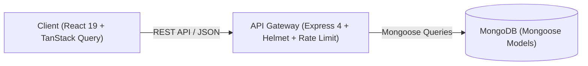

# BlogHub Documentation

Technical documentation and developer resources for **BlogHub** — full-stack publishing platform with real-time markdown authoring, read-through analytics, and administrative governance.

---

## 📚 Documentation Index

| Section | Focus / Purpose |
| :--- | :--- |
| **[Architecture & Design](architecture/overview.md)** | System topology, tiers, request lifecycle, and data flow. |
| **[Architecture Decisions (ADRs)](architecture/decisions.md)** | Key technical trade-offs (Auth, State Machines, In-Memory Testing). |
| **[API Specification](reference/api.md)** | Endpoints catalog, request validation, and status contracts. |
| **[Database Schema](reference/database.md)** | Collections, schemas, relationships, and performance indexes. |
| **[Security & Auth](security/auth.md)** | Stateless JWT strategy, `tokenVersion` revocation, and RBAC matrix. |
| **[Developer Setup](guides/getting-started.md)** | Local environment setup, environment variables, seeding, and running tests. |
| **[Testing Guide](guides/testing.md)** | Integration testing strategies with Jest and Vitest. |

---

## 🛠️ Quick Architecture Summary

---

## 📝 Document Guidelines
- Keep documentation aligned with actual code implementation.
- Technical decisions and improvements are documented alongside feature branches.
