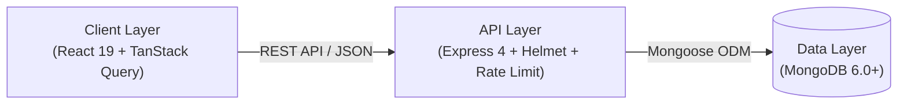

# BlogHub Documentation

Technical documentation and engineering specifications for **BlogHub** — a production-grade full-stack publishing platform with live Markdown editing, read-through analytics, and administrative governance.

---

## 🧭 Documentation Map

Har document ka purpose aur boundary clearly defined hai:

| File | Kya milega isme? (Scope) |
| :--- | :--- |
| **[`system-design.md`](system-design.md)** | **Pura System Flow:** High-level architecture, End-to-end request lifecycle, JWT + `tokenVersion` auth mechanics, aur key engineering trade-offs (ADRs). |
| **[`backend.md`](backend.md)** | **Backend Internals:** Express middleware pipeline, controller layering, error handling, rate limiting, and security configurations. |
| **[`frontend.md`](frontend.md)** | **Frontend Internals:** React 19 architecture, TanStack Query caching strategy, client routing, and split Markdown authoring studio. |
| **[`api.md`](api.md)** | **API Contracts:** Complete catalog of REST endpoints, request parameters, validation rules, and response shapes. |
| **[`database.md`](database.md)** | **Data Models:** MongoDB collections, Mongoose schemas, compound indexes, and relationship constraints. |
| **[`getting-started.md`](getting-started.md)** | **Local Setup:** Prerequisites, environment variables, seeding demo data, and running local servers. |
| **[`testing.md`](testing.md)** | **Testing Strategy:** Backend integration testing (`mongodb-memory-server` + Jest) aur Frontend testing (Vitest + RTL). |
| **[`posts/`](posts/)** | **Engineering Case Studies:** Deep dives aur technical posts drafted for LinkedIn & dev showcases. |

---

## 🏗️ High-Level System Architecture

