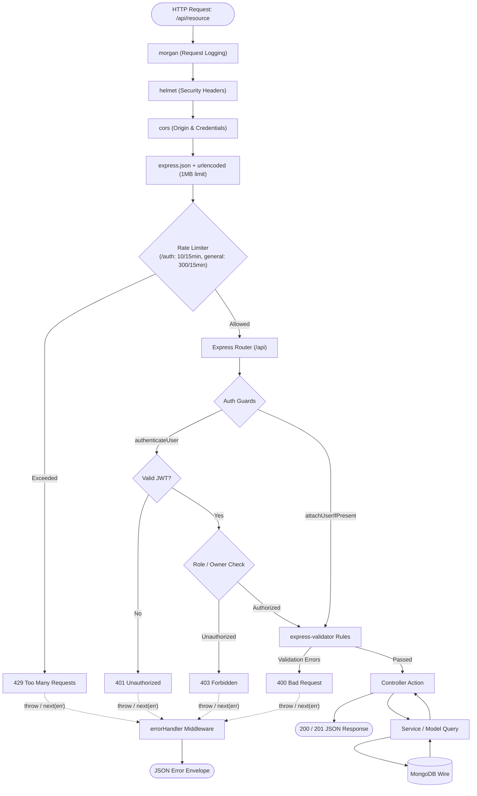

# ⚙️ Backend Architecture & Engineering Reference

> **Scope:** Architecture of the Express.js API layer — request lifecycle, middleware pipeline, service layering, error handling contracts, and cross-cutting concerns.

---

## 📌 Document Maintenance Guide (Where to Update)

Use this reference table when modifying backend codebase:

| If you are doing this in code: | Update this section in this doc: |
| :--- | :--- |
| Adding new global middleware or startup logic | **Section 1 (Composition Root & Startup)** |
| Adding/modifying middleware logic (`auth`, `upload`) | **Section 3 (Middlewares & Guards)** |
| Adding a new controller or route | **Section 4 (Route & Controller Layering)** |
| Modifying error formats or custom `AppError` | **Section 5 (Error Handling & HTTP Contracts)** |
| Updating Rate Limiting, CORS, or Multer uploads | **Section 6 (Cross-Cutting Concerns)** |
| Introducing caching (e.g., Redis) or architectural changes | **Section 7 (Architectural Decisions & Future Work)** |

---

## 📑 Table of Contents
1. [Tech Stack & Dependencies](#1-tech-stack--dependencies)
2. [Composition Root & Startup](#2-composition-root--startup)
3. [HTTP Request Lifecycle Diagram](#3-http-request-lifecycle-diagram)
4. [Middlewares & Guards](#4-middlewares--guards)
5. [Route, Controller & Service Layering](#5-route-controller--service-layering)
6. [Error Handling & HTTP Contracts](#6-error-handling--http-contracts)
7. [Cross-Cutting Concerns (Security, Uploads, Rate Limiting)](#7-cross-cutting-concerns)
8. [Architectural Decisions & Future Work](#8-architectural-decisions--future-work)
9. [Step-by-Step Guide: Adding a New Backend Resource](#9-step-by-step-guide-adding-a-new-backend-resource)

---

## 1. Tech Stack & Dependencies

| Concern | Package / Technology | Version | Purpose in BlogHub |
| :--- | :--- | :--- | :--- |
| **Runtime** | Node.js | v18+ | JavaScript runtime environment |
| **Framework** | `express` | 4.18 | REST API HTTP server and routing |
| **Database ODM** | `mongoose` | 8.24 | Schema modelling, validation, and MongoDB queries |
| **Authentication** | `jsonwebtoken` | 9.0 | Stateless dual-token JWT signing and verification |
| **Password Hashing** | `bcryptjs` | 2.4 | Salted credential hashing (cost factor 12) |
| **Validation** | `express-validator` | 7.0 | Declarative input sanitization and schema checks |
| **Security Headers** | `helmet` | 8.3 | Sets HTTP security response headers |
| **Rate Limiting** | `express-rate-limit` | 8.6 | IP-based request throttling (general + auth limiter) |
| **File Uploads** | `multer` | 1.4 LTS | Memory buffer handling for user avatar uploads |
| **Request Logging** | `morgan` | 1.10 | HTTP request logger (`dev` and `combined` formats) |
| **CORS** | `cors` | 2.8 | Cross-origin resource sharing policy |
| **Configuration** | `dotenv` | 16.4 | Environment variable loader from root `.env` |
| **Module System** | CommonJS (`require`) | — | Native Node.js module format used across backend |

---

## 2. Composition Root & Startup

The backend entry point is `backend/index.js`. The order in which middlewares and listeners mount is strict:

```js
1  dotenv.config({ path: '../.env' })       // Load environment configuration
2  assertEnv()                              // Fail-fast on misconfigured environment variables
3  connectDB()                              // MongoDB connection (skipped in NODE_ENV=test)
4  app.use(logger)                          // Morgan HTTP logger
5  app.use(helmet())                        // Helmet security headers
6  app.use(cors(...))                       // CORS policy (credentials enabled when CLIENT_URL is set)
7  app.use(express.urlencoded({ limit: '1mb' }))
8  app.use(express.json({ limit: '1mb' }))
9  app.get(['/health','/ready'], ...)        // Health and readiness probes (unthrottled)
10 router.use(generalLimiter)                // General rate limiter: 300 req / 15 min
11 router.use('/auth', authLimiter)          // Strict auth limiter: 10 failed req / 15 min
12 router.use('/<resource>', <resource>Routes) // Resource sub-routers mounted at /api/<resource>
13 app.use('/api', router)                  // Unified /api mount point
14 app.use(errorHandler)                     // Terminal error middleware (must be last)
15 app.listen(PORT) unless running on Vercel
16 module.exports = app                      // Exported for testing and serverless handlers
```

### Serverless & Test Lifecycle
```js
const shouldListen = process.env.NODE_ENV !== "test" && !process.env.VERCEL;
if (shouldListen) app.listen(PORT);
module.exports = app;
```
- **Local Dev:** Starts standalone HTTP server listening on `PORT`.
- **Serverless (Vercel):** Invoked directly as an exported request handler.
- **Automated Tests (Jest):** Supertest drives `app` directly without port-binding leaks.

### Health Probes
- `GET /health`: Liveness probe (uptime and process status).
- `GET /ready`: Readiness probe (pings MongoDB and answers `503` if connection is down). Mounted directly on `app` before rate limiters.

---

## 3. HTTP Request Lifecycle Diagram



---

## 4. Middlewares & Guards

Middlewares reside in `backend/middlewares/`:

| Middleware | Purpose & Responsibility |
| :--- | :--- |
| `authenticateUser` | Validates Bearer token, enforces `type: 'access'`, verifies matching `tokenVersion` against the database. Sets `req.user = { id, _id, roles }`. |
| `attachUserIfPresent` | Populates `req.user` if a valid token exists, but does not block unauthenticated users (for public routes with personalized states). |
| `authorizeAdmin` | Checks for `'admin'` role in `req.user.roles`, returns `403 Forbidden` if absent. |
| `authorizeSelfOrAdmin(param)` | Verifies `req.params[param]` matches the authenticated user ID unless admin. |
| `validate` | Intercepts `express-validator` failures and returns a consolidated `400 Bad Request` with field errors. |
| `validateObjectId(name, source)`| Rejects malformed 24-character hexadecimal IDs before executing database queries. |
| `asyncHandler(fn)` | Wraps asynchronous handlers to forward unhandled promise rejections directly to `errorHandler`. |
| `uploadAvatar` | Multer memory storage (capped at 2 MB with strict image MIME allowlist). |
| `errorHandler` | Terminal error middleware translating errors into normalized JSON responses. |
| `logger` | Morgan HTTP logging (`dev` format in development, `combined` in production). |

---

## 5. Route, Controller & Service Layering

### `routes/` (Routing Table)
Routers declare URL endpoints and bind middleware chains without embedding business logic:
```js
router.get("/", AuthUser.attachUserIfPresent, PostControllers.getBlogs);
router.post("/", AuthUser.authenticateUser, PostControllers.postBlogs);
```

### `controllers/` (HTTP Interface)
Controllers inspect `req.params`, `req.query`, and `req.body`, invoke services or queries, choose status codes, and return JSON responses.

### `services/` (Business & Multi-Step Logic)
Services handle complex workflows spanning multiple collections:

| Service | Function | Steps / Business Rules |
| :--- | :--- | :--- |
| `postService` | `createPost` | Creates post → attaches ID to `User.posts` → rolls back with compensating delete if author lookup fails. |
| | `updatePost` | Validates fields → performs `findByIdAndUpdate` with schema validators enabled. |
| `commentService` | `createComment` | Creates comment → pushes ID to `Post.comments` → rolls back if post lookup fails. |
| `accountService` | `purgeAccount` | Cascading account deletion: deletes user's posts, comments, likes, reads, tags, follower references, and profile image buffer. |
| `trendingService`| `getTrendingPosts`| Aggregates views, likes, comments, and reads inside a 14-day sliding window to rank trending stories. |

---

## 6. Error Handling & HTTP Contracts

### Global AppError Contract
Controllers throw typed errors using `utils/AppError.js`:
```js
const post = await Post.findById(req.params.id);
if (!post) throw notFound("Post not found");
```

### Standard Response Envelopes
**Successful Response:**
```json
{
  "success": true,
  "message": "Story published successfully",
  "data": { ... },
  "pagination": { "page": 1, "limit": 10, "total": 45 }
}
```

**Error Response:**
```json
{
  "success": false,
  "message": "Validation failed",
  "error": "BAD_REQUEST",
  "errors": [
    { "field": "email", "message": "Valid email address required" }
  ]
}
```

### Standard Status Codes
- `200 / 201`: Success / Resource Created.
- `400`: Validation error or malformed MongoDB ObjectId.
- `401`: Missing, expired, or invalid token claim.
- `403`: Forbidden (insufficient roles or resource ownership).
- `404`: Resource not found (also used for private/draft posts to avoid exposing existence).
- `409`: Conflict (duplicate email, duplicate username, duplicate like).
- `429`: Rate limit threshold exceeded.
- `500`: Internal unhandled server error.

---

## 7. Cross-Cutting Concerns

### Stateless Authentication with `tokenVersion`
- **Access Tokens:** 15-minute expiration, signed with `JWT_SECRET`.
- **Refresh Tokens:** 7-day expiration, signed with `JWT_REFRESH_SECRET`.
- **Instant Revocation:** Incrementing `user.tokenVersion` in the database immediately invalidates all active tokens across devices.

### Input Validation & ReDoS Prevention
- Validation rules are declared in `backend/validators/` using `express-validator`.
- Rule sets distinguish between creation and partial updates using factories (`postRules(partial)`).
- Search query parameters escape regex metacharacters to prevent Regular Expression Denial of Service (ReDoS).

### Rate Limiting & Proxy Trust
- `generalLimiter`: 300 requests per 15 minutes per IP.
- `authLimiter`: 10 failed login attempts per 15 minutes (`skipSuccessfulRequests: true`).
- `app.set('trust proxy', 1)` ensures real client IPs are evaluated behind reverse proxies and CDNs (Vercel).

### Avatar Uploads
- Stored as image buffer in `UserProfile.image.data` (2 MB cap).
- Served with client caching via `GET /users/:id/avatar` returning `ETag` headers.

---

## 8. Architectural Decisions & Future Work

| Decision | Rationale | Trade-off |
| :--- | :--- | :--- |
| **Layered MVC + Services** | Clean separation of concerns with low boilerplate. | Small CRUD endpoints bypass service layer directly to controllers. |
| **Stateless JWT + `tokenVersion`** | High scalability across serverless and containers without session stores. | Requires one database read per authenticated request. |
| **Separate Secrets per Token** | Prevents refresh tokens from being replayed as access tokens. | Requires managing two secret keys (`JWT_SECRET`, `JWT_REFRESH_SECRET`). |

---

## 9. Step-by-Step Guide: Adding a New Backend Resource

When adding a new feature or endpoint, follow this sequence:
1. **Model:** Declare schema and indexes in `backend/models/<resource>.model.js`.
2. **Validator:** Add input validation rules in `backend/validators/<resource>.validator.js`.
3. **Service (Optional):** Add reusable business logic in `backend/services/<resource>Service.js`.
4. **Controller:** Implement endpoint handlers in `backend/controllers/<resource>.controllers.js`.
5. **Route:** Bind route paths and middlewares in `backend/routes/<resource>.routes.js`.
6. **Mount:** Register router in `backend/index.js` (`router.use('/<resource>', <resource>Routes)`).
7. **Documentation:** Add endpoint specs to `docs/api.md` and schema to `docs/database.md`.
