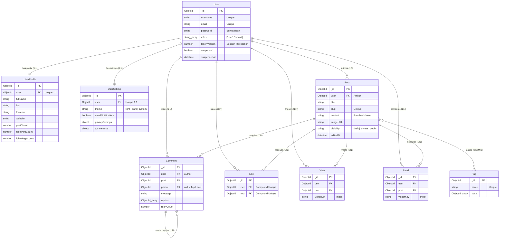

# 🗄️ Database Architecture & Schemas

> **Scope:** Complete MongoDB data models, Mongoose schemas, entity relationships, query patterns, and performance indexes.

---

## 📌 Document Maintenance Guide (Where to Update)

Use this reference table when making codebase changes:

| If you are doing this in code: | Update this section in this doc: |
| :--- | :--- |
| Adding a new Mongoose model | **Section 2 (Collections)** & **Section 3 (Entity Relationships)** |
| Adding/modifying schema fields or constraints | **Section 4 (Model Schemas)** |
| Adding a new index (`schema.index(...)`) | **Section 5 (Performance Indexes)** |
| Optimizing aggregations or population queries | **Section 6 (Query Patterns)** |
| Changing seeding logic or demo credentials | **Section 8 (Seed Data)** |

---

## 📑 Table of Contents
1. [Database Engine & Connection](#1-database-engine--connection)
2. [Active Collections Catalog](#2-active-collections-catalog)
3. [Entity Relationship Diagram (ERD)](#3-entity-relationship-diagram-erd)
4. [Model Schemas & Field Constraints](#4-model-schemas--field-constraints)
5. [Performance Indexes](#5-performance-indexes)
6. [High-Traffic Query Patterns](#6-high-traffic-query-patterns)
7. [Data Integrity & Cascades](#7-data-integrity--cascades)
8. [Seed Data & Demo Accounts](#8-seed-data--demo-accounts)
9. [Schema Design Conventions](#9-schema-design-conventions)

---

## 1. Database Engine & Connection

- **Engine:** MongoDB via **Mongoose 8**.
- **Connection Module:** `backend/config/db.js`.
- **URI Resolution Order:** Reads `MONGODB_URI`, `MONGO_DB_URI`, or `DB_URI` from root `.env`.
- **Automatic Timestamps:** Every schema declares `{ timestamps: true }`, ensuring `createdAt` and `updatedAt` are managed automatically by Mongoose.

---

## 2. Active Collections Catalog

Nine active Mongoose models and collections operate within BlogHub:

| Model | Collection | Purpose | State |
| :--- | :--- | :--- | :--- |
| `User` | `users` | Core credentials, authentication state, and authorization roles. | Active |
| `UserProfile` | `userprofiles` | Author bio, avatar buffer, social handles, and engagement counters. | Active |
| `UserSetting` | `usersettings` | UI preferences, theme selection, and notification flags. | Active |
| `Post` | `posts` | Published articles, drafts, and Markdown body content. | Active |
| `Comment` | `comments` | Top-level discussions and threaded nested replies. | Active |
| `Tag` | `tags` | Topic and keyword taxonomy. | Active |
| `Like` | `likes` | Individual article like events (enforces one like per user/post). | Active |
| `View` | `views` | Page view impression events (tracks visitor keys). | Active |
| `Read` | `reads` | Completed read events for analytics and trending ranking. | Active |

---

## 3. Entity Relationship Diagram (ERD)



---

## 4. Model Schemas & Field Constraints

### `User`
| Field | Type | Constraints & Notes |
| :--- | :--- | :--- |
| `username` | String | Required, trim, unique index. |
| `email` | String | Required, trim, lowercase, unique index. Normalization is handled at the schema level. |
| `password` | String | Required, bcrypt hash (cost 12). |
| `roles` | [String] | Enum: `['user', 'admin']`, default `['user']`. |
| `tokenVersion` | Number | Default `0`. Stamped in JWTs to allow instant stateless global revocation. |
| `suspended` | Boolean | Default `false`. When true, blocks sign-in and authenticated requests. |
| `suspendedAt` | Date | Stamped upon account suspension, cleared when restored. |
| `profile` | ObjectId → `UserProfile` | 1:1 relation to user profile document. |
| `settings` | ObjectId → `UserSetting` | 1:1 relation to user settings document. |
| `posts` | [ObjectId → `Post`] | Denormalized authorship list. |

### `UserProfile`
| Field | Type | Constraints & Notes |
| :--- | :--- | :--- |
| `user` | ObjectId → `User` | Required, unique index. |
| `image.data` / `image.contentType` | Buffer / String | Stores avatar binary data; served via `GET /users/:id/avatar`. |
| `bio`, `fullName`, `location`, `website` | String | Trimmed strings. |
| `socialLinks` | Object | `{ twitter, github, linkedin }`. |
| `followers` / `followings` | [ObjectId → `User`] | Array of user references. |
| `postCount`, `followersCount`, `followingsCount` | Number | Default `0`. |

### `UserSetting`
| Field | Type | Default | Notes |
| :--- | :--- | :--- | :--- |
| `user` | ObjectId → `User` | Required | Unique 1:1 relation to user. |
| `theme` | String | `'system'` | Enum: `'light' \| 'dark' \| 'system'`. |
| `emailNotifications` | Boolean | `true` | Toggle for platform notifications. |
| `privacySettings` | Object | Defaults | `{ showEmail: false, showActivity: true }`. |
| `appearance` | Object | Defaults | `{ fontSize: 'md', colorScheme: 'default' }`. |

### `Post`
| Field | Type | Constraints & Notes |
| :--- | :--- | :--- |
| `user` | ObjectId → `User` | Required author reference. |
| `title` | String | Required. |
| `slug` | String | Required, unique index. Generated from title or custom specified. |
| `content` | String | Required raw Markdown, capped at 100,000 characters. |
| `imageURL` | String | Optional cover image link. |
| `visibility` | String | Default: `'draft'`. Enum: `'draft' \| 'private' \| 'public'`. |
| `tags` | [ObjectId → `Tag`] | Max 5 tags per story. |
| `views` | [ObjectId → `View`] | Historical impression references. |
| `likes` | [ObjectId → `Like`] | Runtime likes array. |
| `comments` | [ObjectId → `Comment`] | Runtime comments array. |
| `editedAt` | Date | Stamped by `postService.updatePost` when content actually changes. |

### `Comment`
| Field | Type | Constraints & Notes |
| :--- | :--- | :--- |
| `user` | ObjectId → `User` | Required comment author. |
| `post` | ObjectId → `Post` | Required target post reference. |
| `parent` | ObjectId → `Comment` | Parent comment ID (`null` for top-level comments). |
| `message` | String | Text body, capped at 5,000 characters. |
| `replies` | [ObjectId → `Comment`] | Nested replies array. |
| `replyCount` | Number | Default `0`. |

### `Tag`
- `name`: String, required, lowercase, unique index, max 30 chars.
- `posts`: Array of referencing `Post` ObjectIds.

### `Like`, `View`, `Read`
- **`Like`:** Contains `user` and `post`. Enforced with a **compound unique index on `(post, user)`** to prevent duplicate likes without race conditions.
- **`View` & `Read`:** Carries `user` (nullable), `post`, and **`visitorKey`** (String).
  - *Visitor Key Algorithm:* Logged-in user uses `u:<userId>`; anonymous visitors use salted HMAC hash `a:<hash>` from IP + User-Agent.
  - Used for deduplication windows to prevent rapid-refresh spam.

---

## 5. Performance Indexes

20 declared indexes across 9 collections (29 including standard `_id` PKs):

| Collection | Index Fields | Purpose / Query Supported |
| :--- | :--- | :--- |
| `users` | `{ email: 1 }` **unique** | Sign-in lookup; prevents duplicate account creation. |
| `users` | `{ username: 1 }` **unique** | Profile lookup and handle uniqueness. |
| `posts` | `{ visibility: 1, createdAt: -1 }` | Fast public feed chronological listing. |
| `posts` | `{ user: 1, createdAt: -1 }` | Author workspace, drafts, and profile story listings. |
| `posts` | `{ editedAt: -1 }` | Administrative moderation log. |
| `posts` | `{ slug: 1 }` **unique** | Rapid story lookup by SEO slug (`/post/:slug`). |
| `comments` | `{ post: 1, parent: 1, createdAt: -1 }` | Top-level comment retrieval (filters `parent: null`). |
| `comments` | `{ post: 1, createdAt: -1 }` | Comment thread listing. |
| `comments` | `{ user: 1, createdAt: -1 }` | Author activity timeline. |
| `likes` | `{ post: 1, user: 1 }` **unique** | Guarantees one like per user per story at the database level. |
| `likes` | `{ user: 1, createdAt: -1 }` | User liked-stories feed. |
| `views` | `{ post: 1, createdAt: -1 }` | View aggregation. |
| `views` | `{ post: 1, visitorKey: 1, createdAt: -1 }` | Deduplication check before counting page impressions. |
| `views` | `{ user: 1, createdAt: -1 }` | User browsing history. |
| `reads` | `{ post: 1, createdAt: -1 }` | Read-through rate aggregation. |
| `reads` | `{ post: 1, visitorKey: 1, createdAt: -1 }` | Deduplication check before recording finished reads. |
| `reads` | `{ user: 1, createdAt: -1 }` | Reading history tracking. |
| `userprofiles` | `{ user: 1 }` **unique** | Rapid profile population on authenticated requests. |
| `usersettings` | `{ user: 1 }` **unique** | User preferences lookup. |
| `tags` | `{ name: 1 }` **unique** | Tag filtering by URL name. |

---

## 6. High-Traffic Query Patterns

### Population Strategy
- `GET /posts/:id`: Performs deep population (author, likes, top comments, comment authors, replies, tags). Excludes sensitive fields (`.select('-password')`).
- `GET /posts`: Lightweight population (only `user` and `tags`) with pagination to avoid high memory overhead.

### Aggregations
- **14-Day Trending Ranking:** Uses four `$lookup` sub-pipelines over `views`, `reads`, `likes`, and `comments` within a 14-day sliding window, followed by a weighted score calculation:
  $$\text{Score} = (2 \times \text{reads}) + \text{likes} + (0.5 \times \text{comments}) + (0.1 \times \text{views})$$
- **Creator Dashboard Analytics:** `getUserAnalytics` aggregates view and read counts using single grouped queries (`countByPost`) rather than looping `countDocuments` per post.

---

## 7. Data Integrity & Cascades

| Action | Cascade Behavior |
| :--- | :--- |
| **Delete Post** | Removes post ID from associated `tags`, deletes attached comments, removes from `User.posts`, and decrements `postCount`. |
| **Delete User** | Handled via `accountService.purgeAccount` (`DELETE /users/me`). Removes profiles, settings, and author references. |
| **Delete Tag** | `DELETE /tags/:id` rejects with `409 Conflict` if any active story is still associated with the tag. |
| **Delete Comment** | Recursively deletes the comment and all its nested children. |

---

## 8. Seed Data & Demo Accounts

The database seed script is located at `backend/scripts/seed.js`:

```bash
npm run seed --prefix backend
```

- Clears existing collections and seeds 15 users, 99 stories (84 public, 10 drafts, 5 private), 10 tags, and randomized engagement (views, reads, comments, likes).
- **Default Test Accounts:**
  - **Member:** `john@example.com` / `password123`
  - **Admin:** `admin@bloghub.com` / `admin123`
- *Safety Guard:* Refuses to run against non-local databases unless `SEED_ALLOW_REMOTE=yes` is explicitly set in environment variables.

---

## 9. Schema Design Conventions

1. **File Convention:** One model per file named `<resource>.model.js` in `backend/models/`.
2. **Model Naming:** Singular PascalCase (e.g., `User`, `Post`), collection is auto-pluralized by Mongoose.
3. **Mandatory Timestamps:** Always include `{ timestamps: true }`.
4. **Strict Schema Definitions:** Declare every field that controllers write to avoid Mongoose strict-mode silent discards.
5. **Index Declaration:** Declare all query indexes directly within the schema file alongside the fields.
