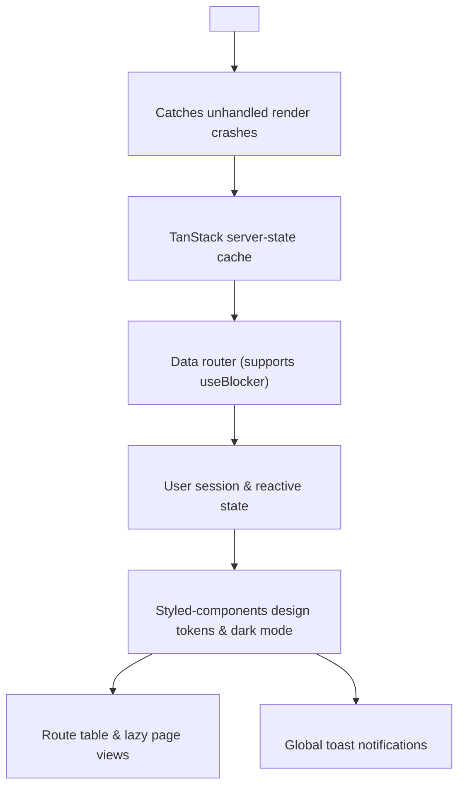
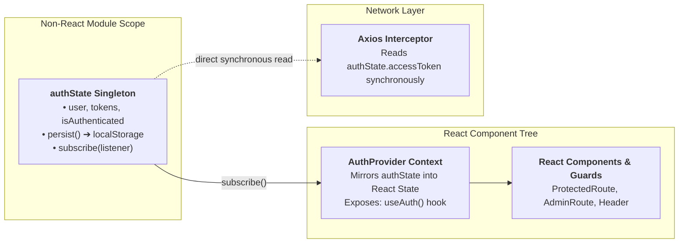
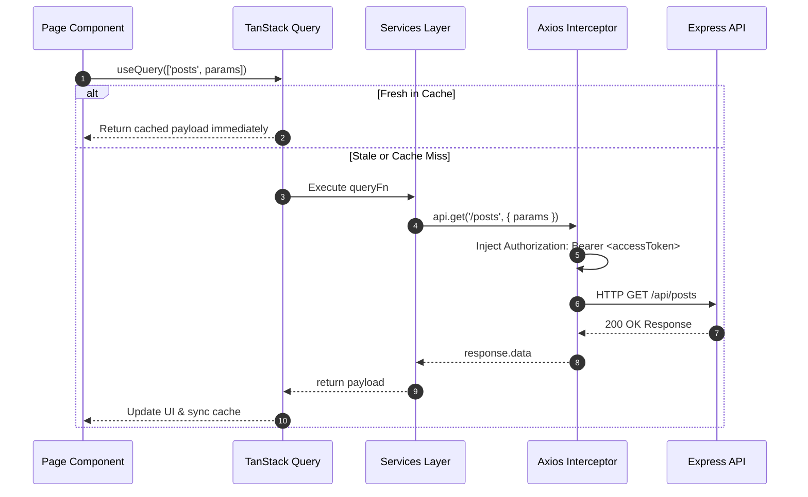

# 💻 Frontend Architecture & Engineering Reference

> **Scope:** Architecture of the React SPA client — provider hierarchy, state ownership, data flow, query caching contracts, component layering, and build performance.

---

## 📌 Document Maintenance Guide (Where to Update)

Use this reference table when modifying frontend codebase:

| If you are doing this in code: | Update this section in this doc: |
| :--- | :--- |
| Adding top-level context providers or error boundaries | **Section 1 (Provider Tree Hierarchy)** |
| Adding new routes, route guards, or lazy code-splitting | **Section 2 (Routing & Access Guards)** |
| Modifying Auth state or synchronous Axios interceptors | **Section 3 (State Ownership & Auth Synchronization)** |
| Adding new API queries, mutations, or query key factories | **Section 4 (Data Flow & TanStack Query Keys)** |
| Adding new UI primitives, design tokens, or layouts | **Section 5 (Component Hierarchy & Boundaries)** |
| Tuning Vite build chunks, bundle sizes, or asset caching | **Section 6 (Performance & Bundle Architecture)** |

---

## 📑 Table of Contents
1. [Tech Stack & Dependencies](#1-tech-stack--dependencies)
2. [Provider Tree Hierarchy](#2-provider-tree-hierarchy)
3. [Routing & Access Guards](#3-routing--access-guards)
4. [State Ownership & Auth Synchronization](#4-state-ownership--auth-synchronization)
5. [Data Flow & TanStack Query Keys](#5-data-flow--tanstack-query-keys)
6. [Component Hierarchy & Boundaries](#6-component-hierarchy--boundaries)
7. [Performance & Bundle Architecture](#7-performance--bundle-architecture)
8. [Step-by-Step Guide: Adding a New Page or API Consumer](#8-step-by-step-guide-adding-a-new-page-or-api-consumer)

---

## 1. Tech Stack & Dependencies

| Concern | Package / Technology | Version | Purpose in BlogHub Client |
| :--- | :--- | :--- | :--- |
| **UI Library** | `react` / `react-dom` | 19.2 | Core declarative UI rendering |
| **Build Tool** | `vite` | 7.2 | Fast ESM development server and Rollup production bundler |
| **Routing** | `react-router-dom` | 7.11 | Client-side routing with `createBrowserRouter` (data router) |
| **Server State** | `@tanstack/react-query` | 5.90 | Caching, background synchronization, and server-state management |
| **HTTP Client** | `axios` | 1.13 | REST client with request/response interceptors for silent auth refresh |
| **Styling Engine** | `styled-components` | 6.2 | CSS-in-JS component-scoped design tokens and theming |
| **Headless UI** | `@radix-ui/react-*` | 1.x / 2.x | Accessible primitives: dialog, dropdown-menu, select, tabs, avatar |
| **Markdown Editor** | `@uiw/react-md-editor` | 4.0 | Synchronized split-pane Markdown writing studio |
| **Markdown Sanitizer** | `rehype-sanitize` | 6.0 | Strict HTML sanitization ensuring XSS-free Markdown rendering |
| **Syntax Highlighting**| `rehype-prism-plus` | 2.0 | Lazy Prism syntax highlighting for code blocks |
| **Iconography** | `lucide-react` | 0.562 | Modern icon set |
| **Toast Notifications**| `react-hot-toast` | 2.6 | Global lightweight notification toasts |
| **Date Utilities** | `date-fns` | 4.1 | Date formatting and relative time calculations |
| **Typography** | `@fontsource-variable/inter` | 5.3 | Self-hosted Inter variable font family |

---

## 2. Provider Tree Hierarchy

Root providers are configured in `client/src/main.jsx` and `App.jsx` in strict top-to-bottom order:



### Key Provider Decisions
- **`ErrorBoundary` at the Top:** Catches render errors anywhere below it, ensuring a graceful fallback UI is rendered instead of a blank white screen.
- **Data Router (`createBrowserRouter`):** Required for `useBlocker`, which prompts authors to confirm navigation before discarding unsaved Markdown drafts in the writing studio.
- **Query Client Defaults:**
  ```js
  { staleTime: 5 * 60 * 1000, retry: 1, refetchOnWindowFocus: false }
  ```
  Content-heavy caching defaults: articles remain fresh for 5 minutes without re-fetching on window tab switches.

---

## 3. Routing & Access Guards

`client/src/App.jsx` defines the routing topology:

### Lazy Loading Pattern
Pages use named exports wrapped in an asynchronous chunk loader:
```js
const lazyPage = (importFn, name) =>
  lazy(() => importFn().then((module) => ({ default: module[name] })));
```
All routes are enclosed within a global `Suspense` boundary displaying a central loading spinner.

### UX Access Guards
- **`ProtectedRoute`:** Checks `isAuthenticated`. Redirects unauthenticated users to `/login` with `state: { from: location }` and `replace: true`.
- **`AdminRoute`:** Requires `isAdmin()`. Redirects unauthorized accounts to `/`.

> *Note:* Client-side guards provide seamless UX redirection. Security is independently enforced by the Express API.

---

## 4. State Ownership & Auth Synchronization

Four distinct state categories exist across the frontend:

| State Kind | Owning Mechanism | Scope & Examples |
| :--- | :--- | :--- |
| **Server State** | TanStack Query v5 | Posts, tags, comments, metrics, author profiles. |
| **Session State** | `authState` singleton + `AuthContext` | Access/Refresh tokens, authenticated user object. |
| **Theme State** | `ThemeProvider` (styled-components) | Light mode vs Dark mode theme tokens. |
| **Local UI State** | React `useState` / `useReducer` | Editor split-pane cursor, open modals, input fields. |

### Auth Synchronisation Architecture
The Axios network interceptor cannot consume React hooks (`useAuth`). Therefore, auth state is decoupled into a module-level singleton:



---

## 5. Data Flow & TanStack Query Keys



### Query Key Factory (`client/src/services/queryKeys.js`)
Centralized query key declarations prevent cache drift across components:

| Factory Function | Generated Key | Consuming Views |
| :--- | :--- | :--- |
| `posts.feed(params)` | `['posts', params]` | Landing Page, Global Search |
| `posts.trending(params)` | `['trendingPosts', params]` | Landing Page (Trending Carousel) |
| `posts.moderation(params)` | `['allPosts', params]` | Admin Dashboard, Admin Moderation |
| `posts.detail(id)` | `['post', id]` | Post Reader (`/post/:id`), Story Editor |
| `posts.mine(params)` | `['myPosts', params]` | Author Workspace (`/stories`), Dashboard |
| `posts.byAuthor(id, page)` | `['authorPosts', id, page]` | Author Public Profile (`/user/:id`) |
| `comments.forPost(postId)` | `['postComments', postId]` | Threaded Comment Discussion Tree |
| `tags.all` | `['tags']` | Tag Cloud, Markdown Editor Tags |
| `search(term)` | `['search', term]` | Global Search Results Page |
| `currentUser()` | `['currentUser']` | Header Byline, Account Settings |
| `analytics.mine()` | `['myAnalytics']` | Author Read-Through Conversion Dashboard |
| `analytics.site()` | `['adminAnalytics']` | Administrative Metrics & Platform Health |
| `admin.users(page)` | `['admin-users', page]` | Administrative User Management Table |

---

## 6. Component Hierarchy & Boundaries

```
client/src/components/
├── layout/     --> Header, Footer, Layout, AdminLayout, WorkspaceLayout, PageShell, ErrorBoundary
├── marketing/  --> HeroIllustration, TopicMarquee (Landing page reading engagement surfaces)
├── posts/      --> PostCard, PostCardSkeleton, PostDetailSkeleton, AuthorByline
├── stats/      --> ReadRateBar (Read-through conversion visualizations)
└── ui/         --> 21 headless-backed design primitives (Button, Modal, Input, Tabs, etc.)
```

### Architectural Layering Rules
1. **`ui/` Primitives:** May only import styled-components and headless primitives. Must have **zero domain knowledge** (never import posts, users, or API services).
2. **Domain Components (`posts/`, `stats/`):** May import UI primitives and formatting utilities. Must receive data via props; never issue direct API fetches.
3. **Pages (`pages/`):** Own data fetching via TanStack Query and state synchronization.

---

## 7. Performance & Bundle Architecture

### Bundle Splitting & Vendor Chunks
Configured in `client/vite.config.js`:

| Chunk Target | Raw Size | Gzip Size | Trigger Conditions |
| :--- | :--- | :--- | :--- |
| `vendor` | 479 kB | 147 kB | Core React, TanStack Query, Axios, date-fns. |
| `index` | 344 kB | 98 kB | Core styling engine, primitives, header, navigation shell. |
| `radix` | 191 kB | 59 kB | Headless accessible UI primitives. |
| `markdown-preview` | 408 kB | 126 kB | Loaded only on reading view (`/post/:id`) and editor. |
| `syntax-highlight` | 626 kB | 225 kB | Loaded on-demand only if an article contains fenced code blocks. |
| `editor` | 75 kB | 25 kB | Loaded on-demand only on author studio routes (`/write`, `/edit/:id`). |

---

## 8. Step-by-Step Guide: Adding a New Page or API Consumer

When creating a new frontend feature:
1. **API Service:** Add async function in `client/src/services/<resource>Service.js` returning `(await api.get(...)).data`.
2. **Query Key:** Add key definition in `client/src/services/queryKeys.js`.
3. **Page Component:** Build page in `client/src/pages/<PageName>.jsx` utilizing `useQuery` or `useMutation`.
4. **Route Registration:** Register lazy route in `client/src/App.jsx` wrapped inside `lazyPage` and the appropriate route guard.
