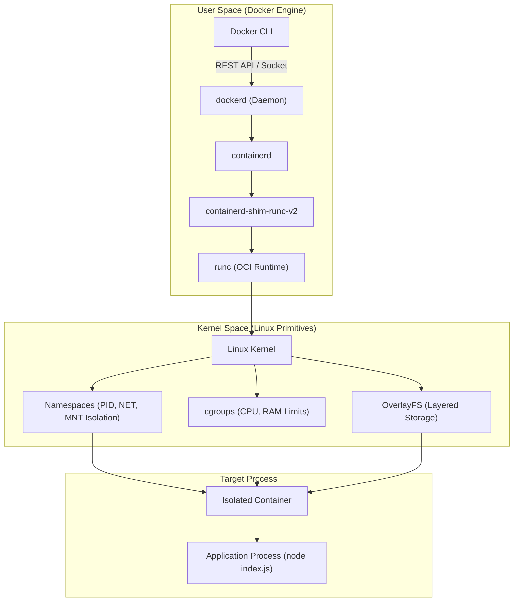

When I was working on one of my full-stack projects, I had to set it up more than once on my own system.

And every time, the same setup headache came back. Installing the right Node version, install dependencies, configure environment variables, make sure everything is compatible, and then finally get the project running.

Honestly, going through the exact same setup ritual every single time was getting annoying.

I just wanted a one-command setup that wouldn't fall apart when moving between machines.

That’s what finally made me turn to Docker.

I had messed around with basic Docker commands before, but this time I wanted to see what was actually going on under the hood.

Before hacking together a Dockerfile, I took a step back to figure out how containers actually tick.

What I found interesting was how many layers are involved before the application process actually starts.

Docker isn't simply creating a small Virtual Machine and putting the application inside it.

The container runtime relies directly on Linux primitives namespaces for process and network isolation, cgroups for resource control, along with layered filesystems.

Understanding that made Docker much more interesting to me.

Then I moved from **understanding Docker** to actually using it in my project.

The basic build flow:

Source Code ➔ Dockerfile ➔ Build Image ➔ Container ➔ App

Instead of treating the Dockerfile as just a random script, I structured it around layer caching and isolation:

1. **Runtime Consistency** Pinned `node:18-alpine` so the OS and Node runtime stay identical across every machine.

2. **Layer Caching** Copied `package.json` before source code to avoid re-running `npm install` on every code change.

3. **Ports & Config** Injected environment variables at runtime and mapped ports (`-p 4000:4000`) to bridge the isolated network.

That’s when the concept clicked for me:

A container isn't a virtual machine or a magical box. It’s just a regular process running on the host kernel, wrapped in its own isolated sandbox

The setup headache was solved:

**Instead of rebuilding the environment manually every time, define it once as code and run the project from that reproducible environment.**

I started with a pretty practical goal make my project easier to set up.

But while working towards that, I ended up learning more about what's happening underneath the container abstraction.

Now I'm looking deeper into image layers, networking, filesystems, and namespaces.

#Docker #SoftwareEngineering #FullStackDevelopment #Containers #Linux #DevOps