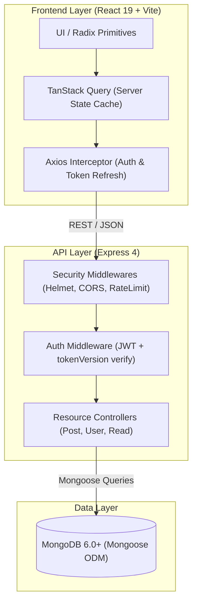
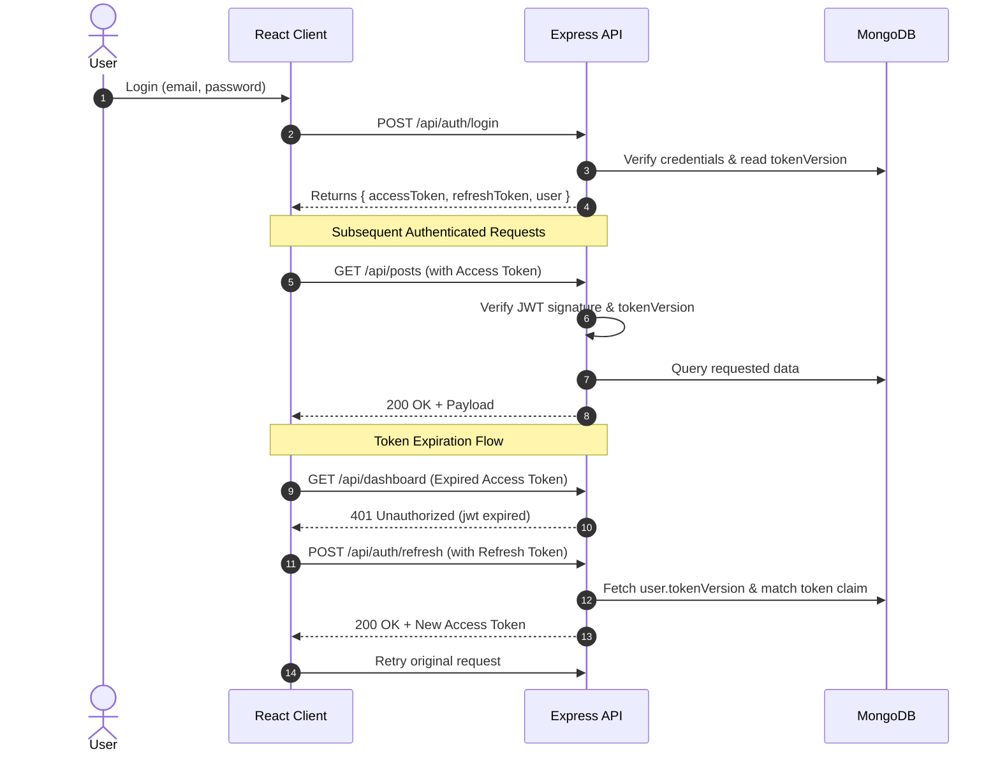

# System Design & Architecture

> High-level system architecture, request lifecycles, authentication model, and core engineering decisions across BlogHub.

---

## 🏗️ System Overview

BlogHub is architected as a decoupled full-stack platform consisting of a React SPA frontend, an Express REST API backend, and a MongoDB persistence layer.

---

## 🔐 Authentication & Session Mechanics

BlogHub uses stateless dual-token JWT authentication with an instant revocation mechanism:

1. **Access Token:** Short-lived (`15m`), sent via `Authorization: Bearer <token>` header.
2. **Refresh Token:** Long-lived (`7d`), used to rotate expired access tokens via `/api/auth/refresh`.
3. **Instant Revocation (`tokenVersion`):**
   - Every `User` record holds an integer `tokenVersion`.
   - Both tokens are stamped with this version.
   - When a user logs out from all devices, resets password, or gets demoted by an admin, `tokenVersion` increments (`+1`).
   - All previously issued tokens become immediately invalid without needing a stateful blacklist.

---

## ⚖️ Key Architectural Decisions (ADRs)

### 1. Stateless Auth with `tokenVersion` vs Server-Side Sessions
- **Context:** Needed scalable auth that works well in both containerized and serverless environments.
- **Decision:** Dual-token JWT with an integer `tokenVersion` on the User document.
- **Outcome:** Zero Redis/Session infrastructure needed initially, while retaining instant revocation capabilities.

### 2. TanStack Query v5 for Server-Side State
- **Context:** Managing data fetching, caching, loading states, and optimistic updates across the SPA.
- **Decision:** TanStack Query instead of Redux/Zustand.
- **Outcome:** Eliminated complex boilerplate; automatic cache deduplication, background re-validation, and smooth UI transitions.

### 3. In-Memory MongoDB for Automated Testing
- **Context:** Integration tests must be isolated, fast, and runnable in CI without external database dependencies.
- **Decision:** `mongodb-memory-server` in Jest test suites.
- **Outcome:** Clean DB state per test suite, 0 mock-drift risk, completely self-contained CI execution.

### 4. Read-Through Tracking with Visitor Deduplication
- **Context:** Accurate reading metrics without double-counting fast page refreshes.
- **Decision:** Compound index on `[post, visitorKey, createdAt]` to de-duplicate repeat visits within reading sessions.
