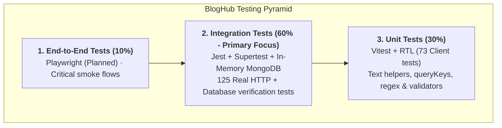
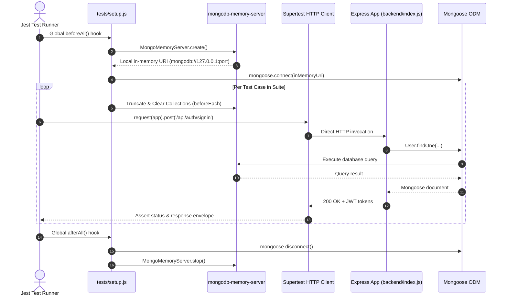

# 🧪 Testing Strategy & Execution Reference

> **Scope:** Comprehensive automated testing architecture across BlogHub — integration testing with in-memory MongoDB, client testing with Vitest/RTL, test runner configuration, execution lifecycle, and testing conventions.

---

## 📌 Document Maintenance Guide (Where to Update)

Use this reference table when modifying or adding automated tests:

| If you are doing this in code: | Update this section in this doc: |
| :--- | :--- |
| Adding backend test files or changing Jest configs | **Section 2 (Backend Integration Testing Suite)** |
| Adding client unit/component tests in Vitest | **Section 3 (Frontend Testing Suite)** |
| Updating test lifecycle fixtures or in-memory DB setup | **Section 4 (Test Lifecycle & Isolation Architecture)** |
| Modifying test commands or coverage flags | **Section 5 (Test Tooling & Execution Commands)** |
| Introducing E2E tests (Playwright) or network mocks (MSW) | **Section 7 (Testing Gaps & Future Roadmap)** |

---

## 📑 Table of Contents
1. [Overview & Testing Pyramid](#1-overview--testing-pyramid)
   - 1.1 [Current Test Coverage Summary](#11-current-test-coverage-summary)
   - 1.2 [Inverted Testing Pyramid Rationale](#12-inverted-testing-pyramid-rationale)
2. [Backend Integration Testing Suite](#2-backend-integration-testing-suite)
   - 2.1 [Runner & Environment Setup](#21-runner--environment-setup)
   - 2.2 [Backend Test Suite Breakdown](#22-backend-test-suite-breakdown)
   - 2.3 [Isolated Execution with `--runInBand`](#23-isolated-execution-with---runinband)
3. [Frontend Testing Suite](#3-frontend-testing-suite)
   - 3.1 [Vitest & React Testing Library Setup](#31-vitest--react-testing-library-setup)
   - 3.2 [Client Test Suite Breakdown](#32-client-test-suite-breakdown)
   - 3.3 [JSDOM Constraints & Radix UI Stubs](#33-jsdom-constraints--radix-ui-stubs)
4. [Test Lifecycle & Isolation Architecture](#4-test-lifecycle--isolation-architecture)
   - 4.1 [In-Memory MongoDB Lifecycle Diagram](#41-in-memory-mongodb-lifecycle-diagram)
   - 4.2 [Collection Cleanup & Isolation](#42-collection-cleanup--isolation)
5. [Test Tooling & Execution Commands](#5-test-tooling--execution-commands)
   - 5.1 [Test Commands Reference](#51-test-commands-reference)
   - 5.2 [Test Suite File Layout](#52-test-suite-file-layout)
6. [Core Testing Principles & Conventions](#6-core-testing-principles--conventions)
   - 6.1 [General Testing Rules](#61-general-testing-rules)
   - 6.2 [Writing Regression Tests](#62-writing-regression-tests)
7. [Testing Gaps & Future Roadmap](#7-testing-gaps--future-roadmap)
   - 7.1 [Client Coverage Gaps](#71-client-coverage-gaps)
   - 7.2 [E2E Testing with Playwright](#72-e2e-testing-with-playwright)
   - 7.3 [Mock Service Worker (MSW) Integration](#73-mock-service-worker-msw-integration)

---

## 1. Overview & Testing Pyramid

### 1.1 Current Test Coverage Summary
BlogHub maintains **198 automated tests** passing across the codebase:
- **Backend:** 125 integration tests (Jest + Supertest + in-memory MongoDB).
- **Frontend:** 73 unit and component tests (Vitest + React Testing Library in jsdom).

| Workspace | Test Runner | Test Count | CLI Command |
| :--- | :--- | :--- | :--- |
| `backend/` | Jest + Supertest + `mongodb-memory-server` | 125 Passing | `npm test` |
| `client/` | Vitest + React Testing Library (jsdom) | 73 Passing | `npm test` |

### 1.2 Inverted Testing Pyramid Rationale
Traditional web apps place unit tests at the base. BlogHub deliberately inverts this pyramid to emphasize **Integration Tests**:



**Why Integration Tests Matter Most Here:**
Nearly all web application defects occur at the database and API seam:
- Mongoose strict-mode dropping undeclared fields.
- Incorrect HTTP status codes and malformed error envelopes.
- Compound unique index collisions and unhandled race conditions.

Unit tests with mocked Mongoose models fail to catch these real-world bugs because the mock assumes the code is already correct. Integration tests against a real MongoDB engine catch them immediately.

---

## 2. Backend Integration Testing Suite

### 2.1 Runner & Environment Setup
- Runs via **Jest**.
- Express `backend/index.js` exports `app` directly without port binding when `process.env.NODE_ENV === 'test'`.
- Supertest drives the Express application directly in-process via HTTP.
- Mongoose connects to an isolated, temporary in-memory MongoDB instance (`mongodb-memory-server`).

### 2.2 Backend Test Suite Breakdown

| Suite File | Tests | Coverage Scope |
| :--- | :--- | :--- |
| `tests/auth.test.js` | 9 | User registration, sign-in, token refresh, `tokenVersion` revocation, suspended accounts. |
| `tests/post.test.js` | 11 | Article CRUD, draft visibility scoping, ownership guards, slug uniqueness checks. |
| `tests/comment.test.js` | 6 | Comment submissions, ownership on deletion, visibility inheritance, pagination. |
| `tests/workspace.test.js` | 14 | Creator workspace: private story listings, responses, metrics scoping. |
| `tests/trending.test.js` | 10 | 14-day trending algorithm, score calculation, minimum-views threshold, fallback. |
| `tests/admin.test.js` | 10 | Role guards, account suspension, role promotion, cascading deletion, last-admin guard. |
| `tests/social.test.js` | 14 | Likes compound unique index, race condition tests, nested comment replies, follower graph. |
| `tests/profile.test.js` | 17 | Public author profile, privacy toggles, author-scoped story feeds. |
| `tests/discovery.test.js` | 25 | Full-text regex search across titles, bodies, tags, authors; visitor deduplication. |
| `tests/moderation.test.js`| 9 | Administrative moderation table: visibility filters, bulk actions, search, status counts. |

### 2.3 Isolated Execution with `--runInBand`
The backend test script enforces `--runInBand`:
```json
"test": "jest --runInBand"
```
Because tests run against an in-memory MongoDB instance, running tests sequentially in a single worker process prevents cross-test race conditions and database collection interference.

---

## 3. Frontend Testing Suite

### 3.1 Vitest & React Testing Library Setup
- Runs via **Vitest** in **jsdom** environment.
- Reuses the existing Vite configuration (`client/vite.config.js`).
- Uses custom render helper (`client/src/test/render.jsx`) that wraps components with full provider hierarchy: TanStack `QueryClientProvider`, `AuthProvider`, `ThemeProvider`, and React Router's `MemoryRouter`.

### 3.2 Client Test Suite Breakdown

| Suite File | Tests | Coverage Scope |
| :--- | :--- | :--- |
| `client/src/services/services.test.js` | 18 | Validates endpoint URLs and query parameters across all Axios API service modules. |
| `client/src/config/api.test.js` | 10 | Axios interceptors: Bearer token injection, silent 401 token refresh, refresh failure redirections. |
| `client/src/utils/text.test.js` | 14 | Markdown syntax stripping, excerpt generation, estimated reading time algorithms. |
| `client/src/pages/UserProfile.test.jsx` | 9 | Author profile rendering, route param extraction, paginated author story feeds. |
| `client/src/pages/admin/admin.test.jsx` | 22 | Admin moderation screens: story moderation, tag manager, user promotion, suspension toggles. |

### 3.3 JSDOM Constraints & Radix UI Stubs
- Radix UI primitives use pointer capture APIs which jsdom does not implement natively.
- `client/src/test/setup.js` provides global shims for `hasPointerCapture` and `setPointerCapture` to prevent dropdown and dialog tests from crashing.
- Custom `renderWithProviders` helper initializes a fresh `QueryClient` with `{ retry: false }` per test to ensure instant assertions on error states.

---

## 4. Test Lifecycle & Isolation Architecture

### 4.1 In-Memory MongoDB Lifecycle Diagram



### 4.2 Collection Cleanup & Isolation
Between individual tests, `tests/setup.js` iterates over all registered Mongoose models and clears collections (`deleteMany({})`). This guarantees zero state leakage between test assertions.

---

## 5. Test Tooling & Execution Commands

### 5.1 Test Commands Reference

#### Backend Commands
```bash
npm test --prefix backend             # Run entire backend integration suite sequentially
npm run test:watch --prefix backend   # Run tests in watch mode during development
npm run test:coverage --prefix backend # Generate coverage report (HTML + terminal summary)
```

#### Frontend Commands
```bash
npm test --prefix client              # Run client Vitest suite
npm run test:watch --prefix client    # Run client tests in watch mode
npm run test:coverage --prefix client # Generate frontend coverage report
```

### 5.2 Test Suite File Layout
```
backend/tests/
├── env.js               --> Test secrets (JWT_SECRET, etc.) loaded before app boots
├── setup.js             --> Starts/stops in-memory Mongo, indexes synchronization, cleanup
└── *.test.js            --> 10 flat integration test suites

client/src/
├── test/setup.js        --> jsdom pointer capture stubs for Radix UI
├── test/render.jsx      --> renderWithProviders wrapper (QueryClient, Auth, Theme, Router)
└── **/*.test.{js,jsx}   --> 5 colocated frontend test suites
```

---

## 6. Core Testing Principles & Conventions

### 6.1 General Testing Rules
1. **Test Observable Behavior:** Test HTTP contracts and database states rather than internal implementation details.
2. **Arrange-Act-Assert (AAA):** Structure tests into three distinct blocks:
   - *Arrange:* Seed documents, prepare tokens.
   - *Act:* Execute Supertest HTTP request.
   - *Assert:* Verify status code, response envelope, and database side effects.
3. **Deterministic & Isolated:** Never rely on network calls or execution order.
4. **Fast Feedback:** Integration tests use in-memory SQLite/MongoDB to maintain execution speed under 60 seconds.

### 6.2 Writing Regression Tests
When fixing a bug, write a regression test verifying the fix:
```js
describe('POST /posts', () => {
  it('creates a post with the requested visibility', async () => { ... });
  it('returns 401 without an access token', async () => { ... });
  it('persists visibility accurately on update', async () => { ... });
});
```

---

## 7. Testing Gaps & Future Roadmap

### 7.1 Client Coverage Gaps
The Markdown authoring studio (`/write`) and Creator analytics dashboard currently lack automated component tests. Adding tests for editor unsaved draft prompts (`useBlocker`) is queued.

### 7.2 E2E Testing with Playwright
Plan to introduce end-to-end user journey tests via Playwright to validate complete browser flows (login ➡️ write markdown article ➡️ publish ➡️ verify public feed).

### 7.3 Mock Service Worker (MSW) Integration
Replace direct module mocking of `api.js` in client tests with Mock Service Worker (MSW) to intercept HTTP traffic at the network level, enabling realistic testing of Axios interceptors.
